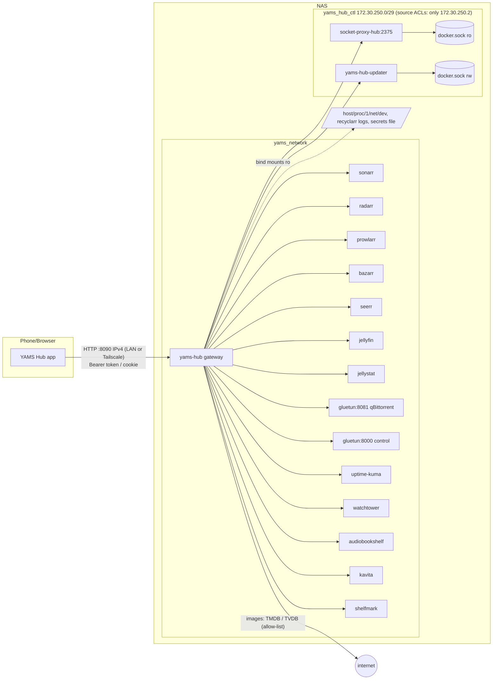

# YAMS Hub: architecture

Status: design baseline, 2026-11-08. This document, [API.md](API.md) and [APP.md](APP.md) are the single source of truth
for the implementers. The integration specs in [integrations/](integrations/) are the source of truth for **upstream**
behaviour (what Sonarr, Seerr, qBittorrent and the rest really do). When this document and an integration spec disagree
about an upstream fact, the integration spec wins. When they disagree about hub design, this document wins.

---

## 1. What we are building

YAMS Hub is an all-in-one control centre for the YAMS media stack on the UGreen NAS "Zenith" (Intel N100, 192.168.10.183).

| Component | What it is | Runs on |
|---|---|---|
| `gateway/` (`yams_hub_gateway`) | Dart (shelf) HTTP server. It holds every API key, talks to the services over the Docker network `yams_network`, and exposes **one** authenticated REST API (`/api/v1`). It also serves the Flutter web build at `/`. | NAS, container `yams-hub` |
| `app/` (`yams_hub`) | Flutter app, Material 3, for Android, iOS and web. It only talks to the gateway. | phones, tablets, browsers |
| `packages/yams_models/` (`yams_models`) | Pure Dart DTOs shared by gateway and app (hand-written `fromJson`/`toJson`). | compiled into both |
| `updater/` (`yams_hub_updater`) | Tiny Dart HTTP service that runs `docker compose pull` + `up -d --no-deps` for one service. The only privileged piece. | NAS, container `yams-hub-updater` |
| `socket-proxy-hub` | Second lscr socket-proxy with the minimal write flags (restart/start/stop, logs). | NAS |

`socket-proxy-hub` and `yams-hub-updater` sit **only** on the control network `yams_hub_ctl` (172.30.250.0/29, fixed
addresses); the gateway is the only container on both `yams_network` and `yams_hub_ctl` (section 6). Network
membership alone does **not** keep other containers out on Zenith (UGOS's `DOCKER-USER` ACCEPT bypasses Docker's
isolation, section 6), so both refuse every peer except the gateway's address 172.30.250.2: the proxy with a
haproxy source ACL, the updater with `UPDATER_ALLOWED_SOURCES` (then its bearer token).

Goals:
- Monitoring (host, containers, uptime, VPN, health), requests (Seerr), library management (Sonarr/Radarr, including
  interactive release search and manual import), downloads (qBittorrent + *arr queues), indexers (Prowlarr), subtitles
  (Bazarr), container control and updates, watch stats (Jellystat), and a launcher with stats for Jellyfin,
  Audiobookshelf, Kavita and Shelfmark.
- A **web-apps launcher** (one tap to every service's own web UI with a status dot), so the web build can replace the
  Homepage dashboard (phase 3, section 10).
- Usable from anywhere through the NAS host's built-in Tailscale, with no router ports opened.

Non-goals (stay in their own apps, the hub only links to them): video playback (Jellyfin), audiobook listening
(Audiobookshelf), reading (Kavita), editing quality profiles (managed by recyclarr), Uptime Kuma monitor editing,
Jellyfin encoding settings, Prowlarr/Sonarr/Radarr settings pages, Shelfmark book search/download in v1 (status and
launcher only; the request flow is v1.1, see section 11).

**Push notifications are a v1 non-goal.** Out-of-app notifications stay in Discord exactly as today (`#alerts`,
`#requests`, `#updates`; monitoring README "Discord routing"). The hub computes alerts only when the app asks
(`GET /dashboard`), and every alert carries a `route` that is also a valid web deep link (`http://<hub>/<route>`), so
a Discord message can link straight into the hub. A gateway-side AlertEvaluator that pushes to a self-hosted ntfy
topic is recorded as a v1.1 option (section 11); it adds no new third-party service when it lands.



---

## 2. Repository layout

No pub workspace. Each package resolves on its own with `path:` dependencies. A workspace would force the gateway's
Docker build to resolve the Flutter app's dependencies, which needs the Flutter SDK inside the image.

```
yams-hub/
├── README.md                     # how to build, run, deploy (core-models slice)
├── .gitignore  .dockerignore
├── analysis_options.yaml         # shared lints; each package `include: ../analysis_options.yaml` (or ../../ for packages/*)
├── tool/check_all.sh             # analyze + test every package, then `docker build` smoke of both images (section 5.20)
├── docs/                         # this design (read-only for implementers)
├── fixtures/                     # captured upstream responses (read-only; used by tests)
├── packages/yams_models/
│   ├── pubspec.yaml              # name: yams_models
│   ├── lib/yams_models.dart      # exports every src file
│   ├── lib/src/json.dart         # JSON read helpers (core)
│   ├── lib/src/common.dart       # ApiError, PagedList, CursorPage, ItemList, Section, SectionStatus, Alert, ServiceId, ExternalApp, ExternalLink, Job, CommandRef (core)
│   ├── lib/src/auth.dart         # users, sessions, tokens, audit (core)
│   ├── lib/src/server.dart       # ping, server config, health (core)
│   ├── lib/src/dashboard.dart    # DashboardResponse (core)
│   ├── lib/src/arr_common.dart   # ArrService, ArrHistoryItem, QualityInfo, MediaFileInfo, HealthMessage (core)
│   ├── lib/src/{requests,library,activity,calendar,indexers,subtitles,containers,system,media}.dart   # one per feature
│   └── test/
├── gateway/
│   ├── pubspec.yaml              # name: yams_hub_gateway
│   ├── Dockerfile                # build context = repo root
│   ├── bin/server.dart           # CLI: serve | hash-password | healthcheck | check-config | reset-admin
│   ├── lib/yams_hub_gateway.dart # library entry (core)
│   ├── lib/src/app.dart          # builds the shelf pipeline
│   ├── lib/src/version.dart      # hubVersion, apiVersion, minAppVersion constants (core)
│   ├── lib/src/config/           # env + yaml config
│   ├── lib/src/core/             # http, auth, upstream, cache, images, jobs, audit, health, dashboard, static, registry
│   ├── lib/src/features/<feature>/   # one folder per feature, entry file <feature>_module.dart
│   └── test/{core,features/<feature>,support}/
├── updater/
│   ├── pubspec.yaml              # name: yams_hub_updater
│   ├── Dockerfile
│   ├── bin/updater.dart
│   └── test/
├── app/
│   ├── pubspec.yaml              # name: yams_hub
│   ├── android/ ios/ web/        # generated by `flutter create`, then edited (section 7.11)
│   ├── lib/main.dart  lib/app.dart
│   ├── lib/core/                 # api, auth, servers, routing, theme, settings, widgets, refresh, links, dashboard
│   ├── lib/features/<feature>/   # screens, providers, <feature>_routes.dart, <feature>_dashboard_card.dart
│   └── test/{core,features/<feature>,support}/
└── deploy/
    ├── docker-compose.hub.yaml   # services to merge into /opt/yams/docker-compose.custom.yaml
    ├── yams-hub.example.yaml     # optional policy file
    ├── make_hub_env.sh           # builds /opt/yams/monitoring/secrets/yams-hub.env (+ updater env) on the NAS
    ├── verify.sh                 # post-deploy checks of section 6 (run on the NAS)
    ├── tailscale-acl.example.hujson  # ACL snippet of section 8
    └── deploy.sh                 # build web + images, ship over ssh, restart
```

Feature ids (used for folder names, model file names, dashboard card keys and audit action prefixes):
`requests`, `library`, `activity`, `calendar`, `indexers`, `subtitles`, `containers`, `system`, `media`, plus the
app-only `settings`.

### 2.1 SDKs and dependencies

Installed toolchain: Flutter 3.47.9 (stable), Dart 3.13.7, in `~/development/flutter` (`source ~/development/env.sh`,
which also sets `JAVA_HOME` to JDK 21 and `ANDROID_HOME`).

| Package | `environment` |
|---|---|
| `yams_models`, `yams_hub_gateway`, `yams_hub_updater` | `sdk: ^3.13.0` (matches the `dart:3.13` build image) |
| `yams_hub` (app) | `sdk: ^3.13.0`, `flutter: ">=3.47.0"` |

**Material library decision (resolved before any slice starts):** the app uses `package:flutter/material.dart`
everywhere and **pins the pre-`material_ui` versions** of the three packages that migrated (go_router 18,
cached_network_image 4 and dynamic_color 2 moved to the standalone `material_ui` package, whose `MaterialApp`/`ThemeData`
are different classes; mixing them breaks `DynamicColorBuilder` at compile time and silently drops go_router's Material
pages and `Theme.of`/`ThemeExtension` lookups). `material_ui` is **never** added, and no app file imports it. This set was
verified on 2026-11-08 with Flutter 3.47.9 in a probe app: `flutter analyze` clean, `flutter build web --release
--no-web-resources-cdn` succeeds, `DynamicColorBuilder` + `MaterialApp.router` + `StatefulShellRoute` + `CachedNetworkImage`
+ fl_chart all compile against one `ThemeData`. Moving to `material_ui` is a later, whole-app migration.

The core slices add dependencies with the commands below, then **commit every `pubspec.lock`**. Feature slices never add,
remove or upgrade dependencies and never run `pub upgrade`. Do not add packages beyond these lists, and never add a
code-generation dependency (`build_runner`, `json_serializable`, `freezed`, `riverpod_generator`).

| Package | Runtime dependencies (constraint as written to pubspec) | Dev |
|---|---|---|
| yams_models | `meta ^1.16.0` | `test ^1.29.0`, `lints ^6.0.0` |
| gateway | `yams_models (path: ../packages/yams_models)`, `shelf ^1.4.2`, `shelf_router ^1.1.4`, `shelf_static ^1.1.3`, `http ^1.6.0`, `http_parser ^4.1.2`, `async ^2.13.0`, `crypto ^3.0.7`, `yaml ^3.1.3`, `logging ^1.3.0`, `args ^2.7.0`, `path ^1.9.1`, `collection ^1.19.1`, `ffi ^2.1.3` | `test`, `lints`, `fake_async` |
| updater | `shelf`, `shelf_router`, `args`, `logging`, `crypto` | `test`, `lints` |
| app | `yams_models (path: ../packages/yams_models)`, `flutter_riverpod ">=3.0.0 <3.5.0"` (resolves 3.4.3; 3.5.0 is days old), `go_router ^17.5.0`, `dio ^5.11.1`, `flutter_secure_storage ^11.2.0`, `shared_preferences ^2.5.6`, `cached_network_image ^3.4.1`, `cached_network_image_platform_interface ^4.1.1` (for `ImageRenderMethodForWeb`, not exported by cached_network_image), `url_launcher ^6.3.3`, `dynamic_color ^1.9.0`, `intl ^0.20.3`, `fl_chart ^1.3.0`, `package_info_plus ^10.2.2`, `device_info_plus ^13.3.0` (login device name), `web ^1.1.2` (sessionStorage in `token_store_web`), `collection ^1.19.1`, `flutter_web_plugins` (sdk; `usePathUrlStrategy`) | `flutter_test`, `flutter_lints ^6.0.0`, `fake_async` |

App command (core-app, right after `flutter create`):
`flutter pub add 'flutter_riverpod:>=3.0.0 <3.5.0' go_router:^17.5.0 dio flutter_secure_storage shared_preferences cached_network_image:^3.4.1 cached_network_image_platform_interface url_launcher dynamic_color:^1.9.0 intl fl_chart package_info_plus device_info_plus web collection 'flutter_web_plugins:{"sdk":"flutter"}' 'yams_models:{"path":"../packages/yams_models"}' dev:fake_async`.

Why these: all are maintained by the Dart/Flutter team or have long-standing active maintenance, and none needs codegen.
`fl_chart` is the only chart library (Stats, host sparklines). `package_info_plus` is only for the About screen.

---

## 3. Shared conventions

These apply to the gateway API and to `yams_models`.

- **JSON field names** are lowerCamelCase. **Enums** are serialised as lowerCamelCase strings. Every enum has an
  `unknown` member, and parsing an unrecognised string yields `unknown` (never throws). Upstream integers (Seerr status,
  Bazarr action codes, Kavita enums) are mapped to named enums in the gateway. The app never sees upstream magic numbers.
- **Instants** are ISO-8601 UTC strings with `Z` (`2026-11-08T07:41:48Z`, fractional seconds allowed). Field names end in
  `At` (`createdAt`) or are named after the event (`airDateUtc`, `nextAiring`). **Calendar dates** without time (Radarr
  release dates, Sonarr `airDate`, Seerr `releaseDate`) are `"YYYY-MM-DD"` strings in fields ending in `Date`. They must
  not be time-zone converted.
- **Sizes** are bytes (`int`, field suffix `Bytes`). **Speeds** are bytes per second (suffix `Bps`). **Durations** are
  seconds (`int`, suffix `Seconds`) unless the name says otherwise (`elapsedMs`). Percentages are `double` 0..100 in fields
  ending in `Percent`; ratios 0..1 in fields named `progress` or ending in `Ratio`.
- **Null handling:** `toJson` omits null fields; `fromJson` treats a missing key as null. Lists are never null (empty
  list instead).
- **Images** are referenced by **gateway-relative paths** (`"/api/v1/img/arr/sonarr/54/poster?size=250&v=63905..."`), never
  absolute URLs, so the same cached image works on LAN and Tailscale. The app prefixes the active server base URL.
- **External links** (open in Jellyfin, ABS web UI, ...) are `ExternalLink {app, path}`; the app resolves the base URL
  (section 7.10).
- **Secrets never leave the gateway.** No DTO contains an API key, password, token of an upstream service, user email,
  internal Docker hostname, container env, mount source path, or upstream stack trace.

---

## 4. `yams_models` package

- Plain immutable classes: `final class X { const X({...}); final T a; factory X.fromJson(Map<String, Object?> j); Map<String, Object?> toJson(); }`.
- No equality/`copyWith` boilerplate unless a screen needs it (then hand-write `copyWith` for that class only).
- `lib/src/json.dart` (core) provides the only parsing primitives every file uses:
  - `typedef JsonMap = Map<String, Object?>;`
  - `int? readInt(Object? v)` (accepts int, double with no fraction, numeric string), `double? readDouble(Object? v)`,
    `String? readString(Object? v)`, `bool? readBool(Object? v)` (accepts `"true"/"false"`), `DateTime? readInstant(Object? v)`
    (parses, returns UTC; returns null for the .NET sentinel `0001-01-01T00:00:00Z`), `List<T> readList<T>(Object? v, T Function(JsonMap) f)`,
    `List<String> readStringList(Object? v)`, `T readEnum<T extends Enum>(Object? v, List<T> values, T fallback)`,
    `Map<String, Object?> compactJson(Map<String, Object?> m)` (drops null values), `String instantToJson(DateTime d)`.
  - Required fields use `readX(j['a']) ?? (throw FormatException('a'))` via a helper `T req<T>(T? v, String field)`.
- Feature files are written by the feature slices. Each feature file may import `json.dart`, `common.dart` and
  `arr_common.dart` but **never another feature file**. Cross-feature types live in `common.dart` / `arr_common.dart`.
- **Naming rule (all 14 src files are re-exported from one library, so a duplicate public name is an
  `ambiguous_export` error that breaks every package):**
  - Every public top-level symbol in `<feature>.dart` is either a DTO named in API.md for that feature, or starts with
    one of that feature's DTO names or with the feature prefix (`Requests`/`Request`, `Library`, `Activity`/`Torrent`/
    `Queue`/`Vpn`/`Transfer`, `Calendar`, `Indexer`/`Release`, `Subtitle`, `Container`/`Update`/`Maintenance`/
    `Decluttarr`/`Recyclarr`, `System`/`Host`/`Uptime`, `Media`/`Jellyfin`/`Watch`/`Audiobook`/`Books`/`Shelfmark`).
    Examples of names that must be prefixed: `RequestOptionsProfile`, `RequestOptionsRootFolder`, `LibraryRootFolder`,
    `LibraryQualityProfile`, `SeasonEpisode` (requests) vs `Episode` (library, named in API.md), `VpnGluetunHealth`,
    `IndexerTag`, `LibraryTag`.
  - Helpers (parsers, mappers, private enums) are library-private (`_x`). No unprefixed top-level functions or
    extensions.
  - **Reserved names** (clash with Flutter/Dart/cached_network_image exports or core): `Page`, `Container`, `Route`,
    `Text`, `Image`, `Icon`, `Badge`, `Card`, `Chip`, `Tab`, `Action`, `DownloadProgress`, `User`(core only), `Job`
    (core only), `Alert` (core only), `Size`, `Key`, `State`, `Filter`, `Category`, `Tag`, `Summary`, `Counts`,
    `Status`, `Health`, `Link`. Use prefixed forms (`ContainerSummary`, `RequestDownloadProgress`).
  - `tool/check_all.sh` runs `dart analyze packages/yams_models` first, so a collision is caught at merge.
- Envelopes are generic and take the item codec explicitly: `PagedList<T>.fromJson(JsonMap j, T Function(JsonMap) item)`
  and `Map<String, Object?> toJson(Map<String, Object?> Function(T) item)`; same for `ItemList<T>` and `CursorPage<T>`.
  (`PagedList`, not `Page`, because Flutter's navigator exports `Page<T>`; the JSON shape is unchanged.)
  `Section` (dashboard cards, API.md §1.6) is **not** generic: it keeps `JsonMap? data` and offers
  `T? decode<T>(T Function(JsonMap) f)` so the app's card widgets decode their own DTO.
- Tests parse gateway-shaped JSON samples (round trip `fromJson(toJson(x))`).

---

## 5. Gateway

### 5.1 Process and CLI

`bin/server.dart` uses `package:args`:

| Command | Purpose |
|---|---|
| `serve` (default) | Load config, open stores, start background services, listen on `0.0.0.0:$YAMS_HUB_PORT`. Handles SIGTERM/SIGINT: stop accepting, wait up to 10 s for in-flight requests, stop pollers, flush stores. |
| `hash-password` | Reads a password from stdin (no echo when a TTY), prints a `pbkdf2-sha256$...` hash. Used to fill `YAMS_HUB_ADMIN_PASSWORD_HASH`. |
| `healthcheck` | `GET http://127.0.0.1:$PORT/api/v1/ping`, exit 0 on 200. Used by Docker `HEALTHCHECK` (the runtime image has no shell or curl). |
| `check-config` | Load config (environment **and** secrets file), print which services are configured and from which source (`env`/`file`; never print values), whether `JELLYFIN_ADMIN_USER_ID` is set or will be auto-detected, the measured PBKDF2 verify time and the iteration count that will be used, and any CORS/policy errors. Exit 1 on invalid config. |
| `reset-admin` | Replace the admin user's password with `YAMS_HUB_ADMIN_PASSWORD_HASH` and revoke all sessions. |

Compiled with `dart compile exe bin/server.dart -o /out/yams-hub`. One process, one isolate for serving; CPU-heavy work
(password hashing) runs in `Isolate.run` behind a global semaphore (5.4). The process sets its umask to `077` at start
(FFI `umask`), so every file it creates under `$DATA` is `0600`/`0700` (the data dir lives on `/volume1/mediashare`,
which may be an SMB share).

### 5.2 Configuration

Configuration = **non-secret environment variables** (URLs, ports, flags; set in compose `environment:`) + a
**secrets file** (keys, passwords, tokens) + an **optional YAML policy file** (non-secret tuning).
`lib/src/config/config.dart` defines an immutable `HubConfig` built by
`ConfigLoader.load(Map<String,String> env, {String? secretsFileContents})`.

**Secrets never go through `env_file`/`environment`**, because Docker copies those into `Config.Env`, which any
container that can reach a socket proxy with `CONTAINERS=1` (the existing `socket-proxy` on `yams_network`) can read via
`GET /containers/{id}/json`. Instead the file `/opt/yams/monitoring/secrets/yams-hub.env` is **bind-mounted** read-only
at `/run/secrets/yams-hub.env`. `ConfigLoader` reads `YAMS_HUB_SECRETS_FILE` (default `/run/secrets/yams-hub.env`),
parses `KEY='value'` lines (single-quoted values; `#` comments and blank lines ignored; a line that does not parse is a
config error naming the line number, never its content), and merges them **over** the environment. A missing file is
allowed (dev); `check-config` reports it. The file is owned by uid 64090, mode `0400` (section 9).

Variables (all optional unless marked; defaults shown). **S** = secret, belongs in the secrets file; everything else
goes in compose `environment:`.

| Variable | Default | Notes |
|---|---|---|
| `YAMS_HUB_PORT` | `8080` | container port |
| `YAMS_HUB_DATA_DIR` | `/data` | users, sessions, audit log, image cache. Must be writable. |
| `YAMS_HUB_WEB_DIR` | `/srv/web` | Flutter web build. If missing, `/` returns a plain "web build not installed" page. |
| `YAMS_HUB_CONFIG_FILE` | `/data/yams-hub.yaml` | optional policy file (section 5.2.1) |
| `YAMS_HUB_SECRETS_FILE` | `/run/secrets/yams-hub.env` | secrets file (above) |
| `YAMS_HUB_ADMIN_USERNAME` | `admin` | bootstrap admin, created only when the user store is empty |
| `YAMS_HUB_ADMIN_PASSWORD_HASH` (S) | required on first start only | output of `hash-password`. **Ignored once `users.json` exists** (logged at info: "bootstrap hash ignored, users exist"); `make_hub_env.sh --drop-bootstrap` removes it from the file after the first start. Used again only by `reset-admin`. A malformed or empty hash never verifies (5.4). |
| `YAMS_HUB_CORS_ORIGINS` | empty | comma-separated exact `http(s)://host[:port]` origins (dev only, e.g. `http://localhost:5173`). `*`, `null`, paths and non-http(s) schemes are a config error (`check-config` fails, `serve` refuses to start). |
| `YAMS_HUB_TRUST_PROXY` | `false` | if true, take client IP from `X-Forwarded-For` and the scheme from `X-Forwarded-Proto` (only if a reverse proxy is added later) |
| `YAMS_HUB_ALLOWED_HOSTS` | empty | optional comma list of extra `Host` header values (5.15). The LAN IP, `100.64.0.0/10`, `*.ts.net`, `localhost` and the hosts of `publicUrls` are always allowed. |
| `YAMS_HUB_LOG_LEVEL` | `info` | `fine`/`info`/`warning`/`severe` |
| `YAMS_HUB_TZ_OFFSET` | `+02:00` | fixed offset for local-time computations (SAST has no DST). Used for "next recyclarr run" and calendar day boundaries. |
| `SONARR_URL` / `SONARR_API_KEY` (S) | `http://sonarr:8989` | |
| `RADARR_URL` / `RADARR_API_KEY` (S) | `http://radarr:7878` | |
| `PROWLARR_URL` / `PROWLARR_API_KEY` (S) | `http://prowlarr:9696` | |
| `BAZARR_URL` / `BAZARR_API_KEY` (S) | `http://bazarr:6767` | |
| `SEERR_URL` / `SEERR_API_KEY` (S) | `http://seerr:5055` | |
| `JELLYFIN_URL` / `JELLYFIN_API_KEY` (S) | `http://jellyfin:8096` | |
| `JELLYFIN_ADMIN_USER_ID` (S) | auto-detected | used for user-scoped Jellyfin calls (recently added, latest). When unset, the gateway picks the first `GET /Users` entry with `Policy.IsAdministrator && !Policy.IsDisabled` (cached 1 h, re-detected on 401/404). `make_hub_env.sh` writes the known id `4c0628aacef24bdfacd40f946ea33ee7` as the default. Kept in the secrets file because it is not exposed anywhere else. |
| `JELLYSTAT_URL` / `JELLYSTAT_API_KEY` (S) | `http://jellystat:3000` | |
| `QBIT_URL` / `QBIT_USERNAME` / `QBIT_PASSWORD` (S) | `http://gluetun:8081` | |
| `GLUETUN_URL` | `http://gluetun:8000` | no secret |
| `DOCKER_URL` | `http://socket-proxy-hub:2375` | no secret; on `yams_hub_ctl`, the proxy accepts only the gateway's 172.30.250.2 |
| `WATCHTOWER_URL` / `WATCHTOWER_TOKEN` (S) | `http://watchtower:8080` | |
| `UPDATER_URL` / `UPDATER_TOKEN` (S) | `http://yams-hub-updater:8080` | on `yams_hub_ctl`, the updater accepts only 172.30.250.2 (`UPDATER_ALLOWED_SOURCES`); token ≥ 32 bytes |
| `UPTIME_KUMA_URL` / `UPTIME_KUMA_SLUG` | `http://uptime-kuma:3001` / `zenith` | no secret |
| `ABS_URL` / `ABS_API_KEY` (S) | `http://audiobookshelf:80` | |
| `KAVITA_URL` / `KAVITA_API_KEY` (S) | `http://kavita:5000` | Kavita Auth Key (header `x-api-key`) |
| `SHELFMARK_URL` | `http://shelfmark:8084` | no secret: Shelfmark runs with `auth_mode: none` (every LAN client is its admin; see 5.18). Configured = URL set. |
| `HOST_SYS` | `/sys` | the container's own sysfs shows the host hwmon devices; no bind mount (a bind of `/sys/class/hwmon` alone leaves its relative symlinks dangling, verified on Zenith) |
| `HOST_NET_DEV` | `/host/proc/1/net/dev` | host network counters (bind mount of that one file, section 6) |
| `RECYCLARR_LOG_DIR` | `/host/recyclarr-logs` | |
| `HOST_VOLUME_MOUNT` | `/volume1` | host path the data volume usage (`statvfs` of the data dir) is reported as |
| `HOST_DISK_DEVICE` | `dm-0` | `/proc/diskstats` device of the data volume; empty disables disk I/O |

Host-global procfs files (`/proc/stat`, `meminfo`, `loadavg`, `uptime`, `cpuinfo`, `diskstats`, `mdstat`) are read from
the container's **own** `/proc` (procfs is not namespaced for these). The whole host `/proc` is not mounted.

A service counts as **configured** when its URL is set and its required secret(s) are non-empty. Unconfigured services
are reported as `disabled` in health and dashboard, and their endpoints return `503 service_not_configured`.
`deploy/make_hub_env.sh` builds the env file on the NAS from the existing secrets (section 9).

#### 5.2.1 Policy file (`yams-hub.yaml`, optional; example in `deploy/yams-hub.example.yaml`)

```yaml
publicUrls: ["http://192.168.10.183:8090", "http://zenith.example-tailnet.ts.net:8090"]  # shown in Settings > About / QR
externalApps:            # how the app reaches the native web UIs; port is combined with the host the app is using
  jellyfin:       {port: 8096}          # optional absolute override: {baseUrl: "http://..."}
  audiobookshelf: {port: 13378}
  kavita:         {port: 5000}
  seerr:          {port: 5055}
  shelfmark:      {port: 8084}
  sonarr: {port: 8989}  radarr: {port: 7878}  prowlarr: {port: 9696}  bazarr: {port: 6767}
  qbittorrent: {port: 8081}  uptimeKuma: {port: 3001}  jellystat: {port: 3002}  portainer: {port: 9000}
policy:
  allowGlobalSearch: false          # MissingEpisodeSearch/CutoffUnmet*/MissingMoviesSearch without an id (README: no bulk searches)
  allowArrDeleteFiles: true         # delete series/movie with files (typed confirmation still required)
  containers:
    locked:  [yams-hub, socket-proxy-hub, yams-hub-updater]   # never stop/restart/update from the hub
    confirm: [gluetun, jellyfin, portainer, socket-proxy, jellystat-db, qbittorrent]  # need confirm=true
    groups:                          # display grouping (matches Uptime Kuma)
      media: [jellyfin, seerr, shelfmark, audiobookshelf, kavita, jellystat, jellystat-db]
      automation: [sonarr, radarr, bazarr, prowlarr, flaresolverr, recyclarr, decluttarr]
      downloads: [gluetun, qbittorrent]
      system: [homepage, portainer, watchtower, socket-proxy, socket-proxy-hub, yams-hub, yams-hub-updater, uptime-kuma]
alerts:
  cpuTempWarnC: 85
  volumeUsedWarnPercent: 90
auth:
  accessTokenTtlMinutes: 60
  refreshTokenTtlDays: 90          # members
  adminRefreshTokenTtlDays: 30     # admins (shorter: an unlocked phone carries admin power)
  pbkdf2Iterations: 600000         # auto-lowered to 310000 at start-up if one verify takes > 1.5 s (5.4)
imageCache:
  maxBytes: 1073741824
  newRemoteEntriesPerUserPerMinute: 300
remoteImageHosts: [artworks.thetvdb.com, image.tmdb.org, assets.fanart.tv, static.tvmaze.com, www.gravatar.com]
```

All keys optional; the values above are the defaults compiled into `HubConfig`.

### 5.3 HTTP pipeline

`lib/src/app.dart` builds one `Handler`:

```
requestId → hostCheck → accessLog → securityHeaders → cors → errorHandler → router
router:
  /api/v1/**  and  /yh/api/v1/**   (the SAME ApiRouter mounted twice; see "cookie prefix" below)
    ping                           (no auth)
    auth/login|refresh             (no auth, rate limited)
    everything else                → authenticate → csrf check → role check (per route) → feature/core handler
  /api/**, /yh/**                  → 404 JSON
  /**                              → static web (SPA fallback)
```

- **Cookie prefix:** bearer clients (Android, iOS, dev web) use `/api/v1`. The gateway-served web build (cookie
  transport) uses **`/yh/api/v1`**, and the hub's cookies are scoped to `/yh/...` paths (5.4). Browsers do not isolate
  cookies by port, so a cookie with `Path=/api` would also be sent to Sonarr, Seerr, qBittorrent and every other web UI
  on the same host; the hub-unique prefix prevents that. The two mounts are identical; a cookie presented on `/api/v1`
  is ignored (only bearer is accepted there) and a bearer token on `/yh/api/v1` is accepted too.
- **hostCheck:** if the `Host` header (without port) is not the LAN IP, a `100.64.0.0/10` address, a `*.ts.net` name,
  `localhost`/`127.0.0.1`, a host from `publicUrls`, or in `YAMS_HUB_ALLOWED_HOSTS`, answer `421 Misdirected Request`
  (plain JSON error `bad_request`). This blocks DNS-rebinding pages from talking to the hub as their own origin.
  `GET /api/v1/ping` is exempt (it is public anyway), so the Docker healthcheck (`127.0.0.1`) and the Uptime Kuma
  monitor (`http://yams-hub:8080/api/v1/ping`) work.
- **requestId:** reuse `X-Request-Id` if it matches `^[A-Za-z0-9-]{8,64}$`, else generate 16 hex chars. Echoed in
  the response header and in every error body.
- **errorHandler:** catches `ApiException` (→ its status/code), `UpstreamException` (→ section 5.6 mapping),
  `FormatException`/`TypeError` from parsing upstream data (→ `502 upstream_bad_response`, logged with the service name),
  anything else (→ `500 internal`, logged with the exception **type** and stack, with the message passed through
  `redactSecrets`, 5.14). Never returns a stack trace or an exception's own text to the client.
- **Routing:** `shelf_router`, built as `Router(notFoundHandler: jsonNotFound)` so unknown paths **and** method
  mismatches return the JSON `404 not_found` body, never shelf_router's plain-text "Route not found". Routes match in
  **registration order**, so:
  - numeric parameters are always regex-constrained: `<id|[0-9]+>`, `<tmdbId|[0-9]+>`, `<n|[0-9]+>`,
    `<seasonNumber|[0-9]+>`; container names use `<name|[a-zA-Z0-9][a-zA-Z0-9_.-]*>`; hashes `<hash|[0-9a-fA-F]{40}>`;
  - within each module, static segments are registered **before** parameterised ones (`/library/tv/lookup` and
    `/library/tv/episodes` before `/library/tv/<id>`, `/containers/events` before `/containers/<name>`,
    `/indexers/history|categories|search|test-all` before `/indexers/<id>`, `/requests/options|counts` before
    `/requests/<id>`, `/discover/genres|watchlist` before `/discover/<slider>`, `/library/releases/grab` and
    `/library/tv/episodes/<id>/releases` before `/library/tv/<id>`, `/activity/queue/import` before
    `/activity/queue/<service>/<queueId>/import`).
  Core wraps it in `ApiRouter`, with methods `get/post/put/patch/delete(path, handler, {Role role = Role.member, bool audit = false})`.
  Handlers have the signature `Future<Response> Function(ApiRequest req)`. `ApiRequest` exposes `user`, `session`,
  `requestId`, `pathParam(name)`, typed query readers (`queryInt('page', defaultValue: 1, min: 1, max: 1000)`,
  `queryEnum`, `queryBool`, `queryList`), `Future<JsonMap> jsonBody()` (max 1 MiB, `400 bad_request` on invalid JSON),
  `requireConfirm()` (section 5.12) and `clientIp`.
- **Responses:** `ApiResponse.json(Object body, {int status = 200, Map headers})` accepts a model (`toJson()`), a `Map` or a
  `List`. JSON is UTF-8 with `Content-Type: application/json; charset=utf-8`. GET JSON responses get a weak ETag
  (`W/"<sha1 of body>"`) and answer `If-None-Match` with 304. Gzip the response when the client sends
  `Accept-Encoding: gzip` and the body is over 1 KiB (`gzip.encode` from `dart:io`).

### 5.4 Authentication and authorisation

**Users** are hub accounts stored in `$DATA/users.json`:
`{id: "u_<12 hex>", username (lowercase, ^[a-z0-9._-]{2,32}$), displayName, role: admin|member, passwordHash, jellyfinUserId?, createdAt, updatedAt, disabled}`.
On first start with an empty store, the bootstrap admin is created from `YAMS_HUB_ADMIN_USERNAME` + `YAMS_HUB_ADMIN_PASSWORD_HASH`.
Admins manage further users in the app (Settings > Users).

**Roles:**

| Role | Can |
|---|---|
| `member` | Read every screen except container logs, container health-check output, the audit log and user/session admin; Jellystat playback history is limited to their own linked Jellyfin user. Create Seerr requests **as their linked Seerr user** (they become PENDING unless that Seerr user can auto-approve), delete their own pending requests, report issues, see their own Jellyfin resume rows. No writes in Library, Activity, Indexers, Subtitles, Containers. |
| `admin` | Everything, including destructive actions (subject to confirmation and policy). |

**Password hashing:** PBKDF2-HMAC-SHA256 (implemented in `core/auth/password_hasher.dart` on top of `package:crypto`'s
`Hmac`), 16-byte random salt, 32-byte output, iterations from config (default 600 000). Format:
`pbkdf2-sha256$<iterations>$<salt base64url no pad>$<hash base64url no pad>`. Verification uses a constant-time compare
and runs in `Isolate.run`.
- **Fail closed:** a stored hash that does not parse (wrong prefix, iterations not an int in 100 000..5 000 000, salt or
  hash not valid base64url of the right length, empty string, e.g. mangled by `$` interpolation) **never verifies**
  and is logged at `severe` once per user.
- **Auto-tuning:** at start-up the gateway times one verification. If it exceeds 1.5 s it uses 310 000 iterations for
  new hashes and logs a warning; `check-config` prints the measurement. Existing hashes keep their stored count.
- **Global verification semaphore** (`core/auth/password_hasher.dart`): at most **2** verifications run at once and at
  most **8** wait; a 9th concurrent attempt gets `429 rate_limited` with `Retry-After: 2` without hashing. Every caller
  that verifies a password (login, `POST /auth/password`, admin password reset of self) goes through it. This bounds
  login CPU on the N100 (which is also Jellyfin's transcode host) to 2 cores regardless of client count.
- Unknown usernames are verified against a fixed dummy hash (through the semaphore) so timing does not reveal whether
  the user exists.

**Tokens** (opaque, no JWT, so there is no signing key to manage and revocation is immediate):
- Access token: `yha_` + 32 random bytes (base64url), TTL 60 min. Kept **in memory only**, indexed twice:
  `sha256(token) → (sessionId, expiresAt)` and `sessionId → Set<tokenHash>`, so revoking a session drops its access
  tokens immediately.
- Refresh token: **self-identifying** `yhr_<sessionId>.<32 random bytes base64url>`. Only `sha256(whole token)` is
  stored. TTL 90 days for members, 30 days for admins (`auth.adminRefreshTokenTtlDays`), **sliding** (each refresh
  resets the expiry) and **rotated** on every use.
- **Refresh and reuse detection** (`POST /auth/refresh`): parse `sessionId` from the token (malformed → `401
  refresh_invalid`); load the session (missing/expired → `401 refresh_invalid`). Then:
  - hash == `refreshHash` → rotate (new pair; old hash moves to `prevRefreshHash`, `prevValidUntil = now + 30 s`);
  - hash == `prevRefreshHash` and `now < prevValidUntil` → rotate again (two requests from one device may race);
  - **any other value while the session exists → revoke the whole session**, drop its access tokens, audit
    `auth.refresh_reuse`, answer `401 refresh_invalid`. This catches the theft case where an attacker has rotated a
    stolen token one or more times and the real device later presents an older one (or vice versa).
- Sessions live in `$DATA/sessions.json` (mode 0600):
  `{id: "s_<12 hex>", userId, deviceName, platform: android|ios|web|other, createdAt, lastSeenAt, lastIp, refreshHash, prevRefreshHash?, prevValidUntil?, expiresAt, proofKey}`.
  `lastSeenAt`/`lastIp` updates are batched (written at most once per minute). `proofKey` is the per-session server
  proof key (below).
- After a gateway restart, all access tokens are invalid; clients get `401 token_expired` and refresh transparently.
- **`authenticate()` loads the user from the user store on every request** (an in-memory map refreshed on every store
  write, so this is free). Role and `disabled` always come from the store, never from the token entry. A missing or
  disabled user → `401 unauthorized` and the session is revoked.
- **Session invalidation rules:**

| Event | Effect |
|---|---|
| User changes own password | revoke every **other** session of that user |
| Admin resets another user's password (`PATCH /admin/users/{id}` with `password`) | revoke **all** of the target's sessions |
| User disabled or deleted | revoke all of their sessions |
| Role changed (promote/demote) | no revoke needed (role is read per request); audit entry |
| `jellyfinUserId` changed | invalidate that user's entry in `ctx.seerrIdentity` (5.5) immediately |
| Refresh-token reuse | revoke that session |

**Server proof** (`core/auth/server_proof.dart`): the login response carries `serverProofKey` (32 random bytes,
base64url, bearer transport only), stored with the session. `GET /ping?nonce=<16..64 b64url chars>&sid=<sessionId>`
adds `proof = base64url(HMAC-SHA256(proofKey, nonce))` when the session exists (otherwise the field is absent; the
response shape is otherwise identical, so `/ping` does not reveal valid session ids beyond what the requester already
holds). `instanceId` is public, so it alone does not authenticate a server; the app sends tokens to a URL only after
the proof verifies (ARCHITECTURE 7.5). Cookie-transport clients are same-origin and skip this.

**Transports:**
- **Bearer** (Android, iOS, and the web app in dev mode when served from another origin): `Authorization: Bearer yha_...`
  on `/api/v1`. Tokens are returned in the login/refresh body.
- **Cookie** (the web app served by the gateway, same origin), on **`/yh/api/v1`** only: login with
  `"transport": "cookie"` sets
  `yh_at=<access>; HttpOnly; SameSite=Strict; Path=/yh/api; Max-Age=3600` and
  `yh_rt=<refresh>; HttpOnly; SameSite=Strict; Path=/yh/api/v1/auth/refresh; Max-Age=<ttl>`.
  `Secure` is added only when the request is HTTPS (or `YAMS_HUB_TRUST_PROXY=true` and `X-Forwarded-Proto: https`).
  Tokens are then **not** in the body. Logout (`POST /yh/api/v1/auth/logout`) revokes the session found through the
  access cookie and clears both cookies.
- **CSRF rules for cookie-authenticated requests:** the header `X-YAMS-Client` is required on **every** request
  (all methods) except `GET /yh/api/v1/img/**` (images load from ``/CanvasKit without custom headers). A custom
  header cannot be sent cross-site without a CORS preflight, which the gateway does not grant for unknown origins.
  `POST /yh/api/v1/auth/login` with `transport: cookie` also requires it (prevents login CSRF). Missing header →
  `403 csrf_rejected`. Requiring it on GETs stops ``-style cross-port requests from
  firing admin-only side effects with the victim's cookie.
- Every `/api` and `/yh/api` response carries `Cross-Origin-Resource-Policy: same-origin`.

Cookie transport exists because `flutter_secure_storage` on web needs WebCrypto, which browsers only expose in secure
contexts (HTTPS or localhost), and the hub is served over plain HTTP on the LAN and tailnet.

**Brute-force protection** (`core/auth/login_limiter.dart`, in memory). Each attempt is **counted against the buckets
before hashing** and refunded on success, so N parallel attempts cannot all slip under a limit:
- Per `(username, ip)`: 5 failures within 15 min lock that pair for 15 min, doubling on each further lockout (max 24 h).
- Per `ip`: 20 failures within 1 h lock the IP for 1 h. **Skipped** when the client IP is loopback or a Docker bridge
  gateway (`172.16.0.0/12` ending in `.1`); in that case the gateway logs a start-up warning once ("client IPs collapse
  to the bridge gateway; use the IPv4-only port binding") because per-IP data is meaningless.
- Per `username` (any IP): 50 failures within 1 h lock the username for 1 h, **except** for IPs that logged in
  successfully as that user within the last 30 days (`$DATA/known_ips.json`, max 20 IPs per user). So an outsider
  cannot keep the admin locked out from the admin's own devices. Refresh keeps existing sessions working during a lock.
- Locked attempts return `429 rate_limited` with `Retry-After` and do **not** run the hash. Successful login resets
  the pair counter. All failures and lockouts are audited (`auth.login_failed`, `auth.locked`).
- `POST /auth/refresh` is limited to 30/min per IP.
- With the IPv4-only port binding (section 6) Docker's userland proxy is not involved for IPv4 and the real client IP is
  preserved; verify `lastIp` in Settings > Sessions after the first login.

**Authorisation** is declared per route (`role:` on `ApiRouter`). The Seerr identity rule is in [API.md](API.md) §6.

### 5.5 Feature modules

Every feature implements one interface from `core/feature_module.dart`:

```dart
abstract class FeatureModule {
  /// Feature id: requests, library, activity, calendar, indexers, subtitles, containers, system, media.
  String get id;

  /// Register this feature's routes. Paths are absolute below /api/v1 and must be the ones API.md assigns to the feature.
  void registerRoutes(ApiRouter router);

  /// Dashboard card for GET /api/v1/dashboard, or null if the feature has no card.
  /// Throwing is fine: the core turns it into an error Section for this card only.
  /// Stubs throw ApiException.notImplemented(), which core maps to {status: error, code: not_implemented}.
  Future<DashboardContribution?> dashboard(ApiRequest req) async => null;

  /// Health probes contributed by the feature (optional; core already pings every service, see 5.10).
  Future<void> start() async {}   // background pollers/streams
  Future<void> stop() async {}
}

final class DashboardContribution {
  const DashboardContribution({required this.data, this.alerts = const []});
  final Map<String, Object?> data;   // the feature's card DTO .toJson()
  final List<Alert> alerts;          // from yams_models common.dart
}
```

`core/feature_context.dart` gives each module everything it needs; modules get it through their constructor
(`LibraryModule(FeatureContext ctx)`):

| Member | Type | Use |
|---|---|---|
| `config` | `HubConfig` | URLs, policy, external apps, alert thresholds |
| `upstreams` | `Upstreams` | one client per service (5.6) |
| `caches` | `CacheFactory` | `ctx.caches.ttl<K, V>(name, ttl, {maxStale, maxEntries})` |
| `pollers` | `PollerFactory` | demand-driven background loops (5.7) |
| `jobs` | `JobRegistry` | long-running actions (5.9) |
| `audit` | `AuditLog` | `await ctx.audit.run(req, action, target, params, () async {...})` |
| `images` | `ImageUrls` | build gateway image paths (5.8) |
| `remoteHttp` | `RemoteFetcher` | outbound internet: `fetch(Uri, {maxBytes, timeout, maxRedirects = 3, allowHost(Uri)})` with manual redirects and the public-address check (5.6); image allow-list and indexer grab use it |
| `jellyfin` | `JellyfinServerInfo` | `Future<String?> serverId()` (Jellyfin `GET /System/Info/Public` `Id`, cached 1 h), `Future<String?> adminUserId()` (config or auto-detect, 5.2), `ExternalLink itemLink(String itemId, String serverId)` (`/web/#/details?id=&serverId=`). Used by core `/server`, requests and media. |
| `seerrIdentity` | `SeerrIdentityResolver` | `Future<SeerrLink?> forUser(User u)` (`SeerrLink {seerrUserId, displayName, avatar?, permissions, canAutoApprove}`; `GET /user/jellyfin/{id}`, cached 1 h per jellyfinUserId; admins without a link → Seerr user 1), `Future<List<SeerrUserRef>> users()` (`GET /user?take=100`, cached 10 min, used by `/admin/jellyfin-users` and `/img/seerr-avatar`), `void invalidate(String hubUserId)`. Core `/auth/me`, `/admin/jellyfin-users`, `/img/seerr-avatar` and the requests feature all use this one instance, so they never disagree. |
| `seerrSettings` | `SeerrPublicSettings` | `Future<SeerrFlags> flags()` (`GET /settings/public`: 4K, partial requests, special episodes; cached 1 h) |
| `health` | `HealthService` | `Future<HealthReport> report()` (the cached 30 s report of 5.10), `ServiceHealth? of(ServiceId)`. Media `/media/apps` uses it. |
| `stores` | `StoreFactory` | `JsonFileStore open(String name)` (atomic write-temp-then-rename under `$DATA`, mode 0600, debounced flush, flushed on stop). Containers uses it for `updates.json`. |
| `redact` | `String Function(String)` | `redactSecrets` (5.14) for every upstream-derived message |
| `clock` | `Clock` | `DateTime now()` (UTC); tests inject a `FakeClock` that can be advanced |
| `log` | `Logger` | `Logger('feature.<id>')` |

`core/feature_registry.dart` is written once by the core slice and imports every
`features/<id>/<id>_module.dart`:

```dart
List<FeatureModule> buildFeatureModules(FeatureContext ctx) => [
  RequestsModule(ctx), LibraryModule(ctx), ActivityModule(ctx), CalendarModule(ctx), IndexersModule(ctx),
  SubtitlesModule(ctx), ContainersModule(ctx), SystemModule(ctx), MediaModule(ctx),
];
```

The core slice creates each `<id>_module.dart` as a **stub** that registers every route API.md assigns to the feature
(with the regex constraints and static-before-parameter order of 5.3) returning `501 not_implemented`, plus
`dashboard()` throwing `ApiException.notImplemented()` (for the nine card features). Feature slices replace the stub's
body; they keep the class name and constructor signature. Feature code may import
`package:yams_hub_gateway/src/core/...`, `package:yams_models` and its own folder, **never another feature folder**.

### 5.6 Upstream clients

`core/upstream/` contains transport and authentication only. Endpoint knowledge (which path, which fields) belongs to
the features.

`UpstreamClient` (one instance per service, built in `Upstreams`):

```dart
class UpstreamClient {
  final ServiceId service; final Uri baseUrl; final bool configured;
  Future<Object?> getJson(String path, {Map<String, Object?>? query, String? rawQuery, Duration? timeout, Map<String,String>? headers});
  Future<Object?> sendJson(String method, String path, {Object? body, Map<String, Object?>? query, String? rawQuery, Duration? timeout, Map<String,String>? headers});
  Future<UpstreamResponse> send(String method, String path, {Object? jsonBody, Map<String,String>? form, List<MultipartPart>? multipart, List<int>? bytes, String? contentType, Map<String, Object?>? query, String? rawQuery, Duration? timeout, Map<String,String>? headers, int? maxBytes}); // raw: status, headers, bodyBytes
  Future<UpstreamStream> openStream(String path, {Map<String, Object?>? query}); // long-lived (docker events/logs follow)
}
// MultipartPart.field(name, value) | MultipartPart.file(name, filename, bytes, contentType)
```

- **Path convention:** `path` is always **absolute from the service root and includes the API prefix**. There is no
  hidden prefix. Examples: Sonarr/Radarr `/api/v3/series`, `/api/v3/queue`, `/MediaCover/54/poster-250.jpg`, `/ping`;
  Prowlarr `/api/v1/indexer`; Bazarr `/api/badges`; Seerr `/api/v1/discover/trending`; qBittorrent
  `/api/v2/torrents/add`; Jellyfin `/Sessions`; Jellystat `/stats/getViewsOverTime`; ABS `/api/libraries`; Kavita
  `/api/Library/libraries`; Watchtower `/v1/check`; gluetun `/v1/publicip/ip`; Uptime Kuma `/api/status-page/zenith`;
  Shelfmark `/api/stats`; updater `/update/sonarr`. **The `DockerClient` alone** prepends the pinned `/v1.54`: callers
  pass `/containers/json` (never `/v1.54/...`). API.md writes upstream paths in shorthand (`series/{id}`,
  `/discover/trending`); implementers expand them with the prefix above. `test/core/upstream_paths_test.dart` asserts
  the exact upstream path for one call per service through `fake_upstreams`.
- Query maps: values may be `String`, `num`, `bool` or `Iterable` (repeated keys, needed for `eventType=1&eventType=3`,
  `indexerIds=`). `rawQuery` bypasses encoding entirely (Seerr's strict encoder lives in the requests feature).
  URIs are built with `baseUrl.replace(pathSegments: ..., query: ...)` from validated segments, never by string
  concatenation of client input (5.8).
- `multipart` builds a `multipart/form-data` body (qBittorrent `torrents/add` with `.torrent` files, used by activity
  and indexers). `maxBytes` aborts the response stream once exceeded (`UpstreamBadResponse` "response too large").
- Default timeout 10 s (`connectionTimeout` 3 s). Per-call overrides as specified in API.md.
- Always sends `Accept: application/json` and `Accept-Encoding: gzip`; `dart:io` `HttpClient` with
  `autoUncompress = true`, `idleTimeout = 15 s`, max 6 connections per host. Never sends `Origin` or `Referer`.
- **Auth strategies** (`core/upstream/auth_strategies.dart`):

| Service | Strategy |
|---|---|
| sonarr, radarr, prowlarr | header `X-Api-Key` |
| bazarr | header `X-API-KEY` |
| seerr | header `X-Api-Key`; callers may add `X-API-User` per call |
| jellyfin | header `Authorization: MediaBrowser Client="YAMS Hub", Device="yams-hub", DeviceId="yams-hub-gateway", Version="<hub version>", Token="<key>"` |
| jellystat | header `x-api-token` |
| watchtower, audiobookshelf, updater | `Authorization: Bearer <token>` |
| kavita | header `x-api-key` |
| gluetun, uptime-kuma, docker, shelfmark | none |
| qbittorrent | `QbitSession` (below) |

- **`QbitSession`:** one session for the whole gateway. Login = `POST /api/v2/auth/login` form; success is 204 with a
  cookie whose name starts with `QBT_SID_` (parse the name from `Set-Cookie`, do not hard-code it). Logins are single-flight.
  On 403 from any call: log in once, retry once. On 401 from login: mark `credentialsRejected` and make **no further
  login attempt for 10 minutes** (5 failures ban the IP for an hour); calls during that window fail fast with
  `502 upstream_auth_failed`. Exposes `int sessionGeneration` so the maindata poller knows to restart from `rid=0`.
- **Errors:** non-2xx responses throw `UpstreamException {service, status, message?, validation?: List<{field, message}>, bodySnippet}`.
  The message extractor knows the shapes: Servarr `{message}` / validation arrays `[{propertyName, errorMessage}]` /
  RFC7807 `{title, errors}`; Seerr `{message}` or `{error}`; Bazarr `{message, errors}`; Jellystat text; Docker
  `{message}`; socket-proxy HTML 403 (→ message "denied by socket proxy"); Shelfmark `{error}`. It **drops**
  `description`, stack traces and anything over 300 chars, and passes what it keeps through `redactSecrets` (5.14).
- **Transport exceptions are never wrapped or re-thrown with their own text**: `package:http` `ClientException` and
  `dart:io` `HttpException`/`SocketException` include the full request URI (with any `apikey=`) in `toString()`.
  `UpstreamClient` catches every transport exception and throws `UpstreamUnavailable` or `UpstreamTimeout` carrying only
  `{service, method, path without query}`.
- **Default mapping** to API errors (features may catch and map more specifically first):

| Upstream condition | API status / code |
|---|---|
| service not configured | 503 `service_not_configured` |
| connection refused / DNS / reset | 503 `upstream_unavailable` |
| timeout | 504 `upstream_timeout` |
| 401/403 from upstream (bad key) | 502 `upstream_auth_failed` |
| 400 `Invalid Hostname` from Sonarr/Radarr/Prowlarr (Allowed Hosts, `UpstreamHostRejected`) | 502 `upstream_host_rejected` with `details.host` |
| 404 | 404 `not_found` (only when the gateway path addressed that upstream resource; otherwise 502) |
| 400 / 422 with validation array | 422 `validation_failed` with `fields` |
| other 4xx | 502 `upstream_error` with `details.upstreamStatus` |
| 5xx | 502 `upstream_error` |
| unparseable body | 502 `upstream_bad_response` |

- **Logging:** each upstream call logs at `fine` `{service, method, path (no query), status, ms}`. Queries are not logged
  because some upstreams accept keys in query strings.
- **`RemoteFetcher`** (outbound internet, `core/upstream/remote_fetcher.dart`): automatic redirects are disabled and at
  most 3 are followed manually. Every hop must be `https` (or the caller's explicit `allowHost` exception) and must
  resolve (`InternetAddress.lookup`) only to **public** addresses: loopback, `10/8`, `172.16/12`, `192.168/16`,
  `100.64/10`, `169.254/16`, `0/8`, `fc00::/7`, `fe80::/10`, `::1` and the `yams_network` subnet are rejected, as are
  single-label names (Docker service names). The body is capped while streaming (`maxBytes`). A redirect to `magnet:`
  is returned to the caller as `RemoteMagnet(uri)` instead of being fetched.

### 5.7 Caching and background work

- `TtlCache<K, V>` (`core/cache/ttl_cache.dart`): `Future<CacheResult<V>> get(K key, Future<V> Function() load)`.
  - **Single-flight:** concurrent misses share one load.
  - **Stale on error:** if a load fails and a value younger than `maxStale` exists, return it with `stale: true`
    (dashboards then show a "stale" badge instead of an error).
  - `invalidate(key)`, `invalidateWhere(test)`, `clear()`; `maxEntries` with LRU eviction.
  - Features invalidate the relevant entries after every successful write.
- TTLs are specified per endpoint in API.md. Rule of thumb: dashboard counters 15–30 s, lists 60 s, TMDB-derived details
  6 h, profiles/root folders 10 min, slow stats (Prowlarr indexerstats, Jellystat views) 5 min, update checks 6 h.
- **Demand pollers** (`core/cache/demand_poller.dart`): `ctx.pollers.create(name, interval, lease, tick)`. `touch()` is
  called by the handlers that read the polled data. The loop runs `tick` every `interval` while the last touch is
  younger than `lease`, then stops. The first `touch()` after idle runs `tick` immediately and awaits it.
  Used for: qBittorrent maindata (1.5 s, lease 20 s), container stats (10 s, lease 60 s).
- **Always-on background tasks** (started in `start()`): host metrics sampler (system, every 5 s, cheap file reads),
  Docker events stream (containers, reconnects with `since=` after drops), periodic Watchtower check (containers,
  every 6 h; it is the **only** caller of `/v1/check`). Core never calls `/v1/check`: `features.watchtowerCheck` is
  probed with `GET /v1/containers/details` (200 → the `check,containers` endpoints are enabled, 404 → not), at start-up
  and every 6 h.
- **Merged-feed cursors** (`core/http/merged_cursor.dart`, used by Activity history): the cursor is base64url JSON
  `{"v":1,"exp":<unix>,"s":{"sonarr":{"page":3,"idx":12},"radarr":{"page":1,"idx":40}}}`. To serve `limit` items the
  gateway loads each source's current page (fixed upstream `pageSize` 50, cached 30 s), repeatedly takes the newest head
  item across sources, advances that source's `idx` (loading the next page when `idx` reaches 50), and stops at `limit`
  or when every source is exhausted. Cursors expire after 10 min.

### 5.8 Image proxy

All images go through the gateway, so phones never need to reach internal hosts and upstream keys never appear in URLs.
Routes and parameters are in [API.md](API.md) §3. Design:

- **`ImageUrls`** (core) builds every path features put in DTOs. Exact signatures (features never hand-build `/img`
  paths):

```dart
String? arr(ArrService svc, int id, String coverType, {int size = 500, String? version, String? fallbackUrl});
String? remote(String? url, {int? width});
String? tmdb(String? path, String size);                    // path with or without leading '/'
String? jellyfin(String? itemId, String type, {String? tag, int? fillHeight, int? fillWidth, int? maxWidth, int? index, int? quality});
String? jellyfinUser(String? userId, {String? tag});
String? abs(String? itemId, {int width = 400, String? version});
String? kavitaSeries(int? seriesId, {String? version});
String? seerrAvatar(int? seerrUserId, {String? version});   // version = the `?v=` of Seerr's avatar path, if any
```

  Every builder returns null for null required input, URL-encodes `fallback`/`u`, snaps sizes to the bucket set below,
  and the result round-trips through the route parser (`test/core/image_urls_test.dart` has one round trip per builder).
- **Input validation before any upstream call** (400 `bad_request` otherwise):

| Parameter | Rule |
|---|---|
| Jellyfin `itemId`, `userId` | `^[0-9a-f]{32}$`; the dashed GUID form is accepted and normalised (lower-case, dashes removed) |
| ABS `itemId` | `^[A-Za-z0-9_-]{1,64}$` |
| arr `id`, Kavita `seriesId`, Seerr user id | positive int |
| TMDB `file` | `^[A-Za-z0-9_-]+\.(jpg|jpeg|png|webp)$` |
| `svc`, `coverType`, `imageType`, TMDB `size` | exact enum |
| size parameters (`fillHeight`, `fillWidth`, `maxWidth`, ABS `w`, remote `w`) | snapped **up** to the bucket set `96, 160, 250, 342, 500, 780, 1280` (larger → 1280) |
| `quality` | clamped to 60..90 |
| `index` | 0..20 |

  Upstream URIs are built with `baseUrl.replace(pathSegments: [...validated segments], queryParameters: {...})`, never
  by concatenation, so a percent-decoded `/` or `?` in a path parameter can never change the upstream path.
- **Seerr avatars:** the avatar comes from `ctx.seerrIdentity.users()`. A value starting with `/` but not `//` is resolved
  with `seerrBase.resolve(avatar)` and the gateway asserts that scheme, host and port are unchanged. An absolute
  `https://` avatar (gravatar) goes through the remote allow-list path (`www.gravatar.com` is in the default
  `remoteImageHosts`), anything else → 404.
- **Content checks:** only `image/jpeg`, `image/png`, `image/webp`, `image/gif` and `image/avif` are accepted, and the
  first bytes must match the magic number of that type (JPEG `FF D8 FF`, PNG `89 50 4E 47`, WebP `RIFF....WEBP`, GIF
  `GIF8`, AVIF `....ftypavif`/`ftypavis`). **SVG is never served** (TMDB/TVDB/fanart.tv host user-uploaded SVG logos,
  which would run script on the hub origin). A mismatch → `502 upstream_bad_response`, nothing cached. The content
  type stored in the cache sidecar is the **sniffed** type, not the upstream header.
- **Size cap:** 15 MB enforced while streaming (bytes counted, fetch aborted at the limit) regardless of
  `Content-Length`.
- **Response headers on every `/img` response:** `Content-Security-Policy: default-src 'none'; sandbox`,
  `X-Content-Type-Options: nosniff`, `Cross-Origin-Resource-Policy: same-origin`, `Content-Disposition: inline`.
- **Disk cache** at `$DATA/cache/images/<sha256(cacheKey)[0:2]>/<sha256>` with a JSON sidecar (`contentType`,
  `fetchedAt`, `bytes`, `version`). The cache key is the normalised gateway path plus the normalised (snapped) query.
  For `/img/arr` the key is `(svc, id, coverType, size)` only: `v` is stored as validation metadata in the sidecar and a
  request with a newer `v` **replaces** the entry in place, so changing `v` cannot multiply entries.
- **Never cache upstream 404 or 5xx** (Sonarr/Radarr send one-year cache headers even on 404). For arr covers a 404
  falls back to the item's `remoteUrl` (the feature passes it as `fallback=`, which must pass the remote allow-list).
- Versioned requests (`v=`/`tag=` present) are served with `Cache-Control: private, max-age=31536000, immutable`;
  unversioned ones with `private, max-age=86400`. ETag = cache key hash.
- Remote fetches (`/img/remote`, `/img/tmdb`, gravatar) use `ctx.remoteHttp` restricted to `remoteImageHosts` over
  HTTPS, at most 2 redirects that stay on the allow-list, 10 s timeout.
- **Growth control:** total cache bytes are tracked in memory (initialised by a scan at start-up). Every write evicts
  LRU entries synchronously while the total exceeds `imageCache.maxBytes`; above 110 % the gateway stops writing and
  serves pass-through. New remote (`/img/remote`, `/img/tmdb`) cache entries are limited per user to
  `imageCache.newRemoteEntriesPerUserPerMinute` (default 300); beyond that the image is served pass-through without
  caching. A background prune every 10 min reconciles the counter with the disk.
- At most 8 concurrent upstream image fetches; identical in-flight fetches are single-flighted.
- No server-side resizing (CPU on the N100 is precious); use upstream size variants (arr `-250/-500`, TMDB `w342/w500/w780`,
  Jellyfin `fillHeight`, ABS `width`).

### 5.9 Jobs

`JobRegistry` (core, in memory, keeps the last 200 jobs for 24 h) tracks anything that takes longer than a normal request:
container restart/stop/start, container updates (via updater), Watchtower checks, Prowlarr indexer tests.

```dart
Job job = ctx.jobs.start(kind: 'containers.restart', target: 'sonarr', userId: req.user.id,
    run: (JobHandle h) async { h.step('Restarting sonarr'); ...; h.log('...'); return {'state': 'running'}; });
return ApiResponse.json({'job': job.toDto()}, status: 202);
```

`GET /api/v1/jobs/{id}` and `GET /api/v1/jobs?active=true` are core routes; for members both only return jobs with
their own `userId`. The DTO is `Job` in `common.dart`. Job `log` lines and `message`/`error` texts derived from
upstream output pass through `redactSecrets` before they are stored. Each job writes an audit entry when it finishes. At most one job per `(kind, target)` runs at a time; a second start returns the
running job (HTTP 202 with the same id).

### 5.10 Health aggregation

`GET /api/v1/health` (core) probes every service in parallel with a 3 s timeout, cached 30 s:

| Service | Probe | Version from |
|---|---|---|
| sonarr / radarr / prowlarr | `GET /ping` (+ `system/status` every 10 min for the version, + `config/host` `allowedHosts` every minute, never past the probe's 3 s: API.md §2.5; latency is `/ping` alone) | `version` |
| bazarr | `GET /api/system/ping` | `/api/system/status` `bazarr_version` |
| seerr | `GET /api/v1/status` | `version` |
| jellyfin | `GET /System/Info/Public` | `Version` |
| jellystat | `GET /auth/isConfigured` | `version` |
| qbittorrent | `GET /api/v2/app/version` (through `QbitSession`) | body text |
| gluetun | `GET /v1/openvpn/portforwarded` | – |
| docker | `GET /_ping` (+ `/version`) | `Version` |
| watchtower | `GET /v1/metrics` (counts against its 60/min limit; at 30 s caching that is fine) | – |
| updater | `GET /healthz` | `version` |
| uptimeKuma | `GET /api/status-page/{slug}` | – |
| audiobookshelf | `GET /status` | `serverVersion` |
| kavita | `GET /api/health` (+ `/api/Server/server-info-slim` with key for version and to detect a rejected key) | `kavitaVersion` |
| shelfmark | `GET /api/health` (unauthenticated, no side effects; 503 with `status: error` when its download coordinator is stopped → `degraded`) | – (the Containers screen shows the image version, 1.6.1 today) |
| host | `HOST_NET_DEV` and `/proc/stat` readable | – |

`docker` health also includes the **proxy self-test** (5.16): if the self-test failed, docker is `degraded` with
message "socket-proxy-hub allows writes it should refuse; container actions disabled".
Health `message` texts derived from upstream bodies pass through `redactSecrets`.

Status per service: `up`, `degraded` (reachable but auth rejected, or slow > 2 s), `down`, `disabled` (not configured).

### 5.11 Dashboard aggregation

`GET /api/v1/dashboard` (core) calls every module's `dashboard(req)` in parallel. Each card has a **4 s budget**: a card
that is not done in time is returned as `{status: "error", error: {code: "upstream_timeout"}}` while its load continues
in the background (it warms the feature's caches, so the next refresh is fast). A throwing card becomes
`status: "error"` with the mapped error; `service_not_configured` becomes `status: "disabled"`. Alerts from all cards
are merged, de-duplicated by `id` and sorted by severity then source. `?cards=a,b` limits the work to some cards. See
API.md §4.

### 5.12 Destructive actions and confirmation

- The app always shows a confirmation dialog first ([APP.md](APP.md) §2.4). The gateway double-checks: endpoints marked
  **[confirm]** in API.md require `confirm=true` (query parameter or JSON body field). Without it they return
  `428 confirmation_required` with `details.impact` (a one-line description of what would happen). Nothing is changed.
  Some endpoints are **conditionally** [confirm] (e.g. `PUT /torrents/{hash}/share-limits` only when the action deletes,
  container actions only for confirm-list containers and every stop); API.md states the condition.
- "Typed" confirmations (deleting media files) are enforced in the app (the user types the title). The gateway only sees
  `confirm=true`. Step-up re-authentication for the most destructive actions is a v1.1 item (section 11); in v1 the
  shorter admin refresh TTL (30 days) limits the window of a stolen unlocked phone.
- Policy switches (`allowGlobalSearch`, `allowArrDeleteFiles`, container `locked`) are enforced in the gateway and return
  `403 policy_denied`.

### 5.13 Audit log

Append-only JSON Lines at `$DATA/audit.jsonl` (mode 0600), rotated at 10 MB (keep 5 files). Entry:
`{id, at, userId, username, sessionId, ip, action, target, params, outcome: ok|error, errorCode?, durationMs}`.
`action` = `<feature>.<verb>` (`library.tv.delete`, `containers.restart`, `auth.login`). Every non-GET route registered
with `audit: true` (all writes) is logged automatically by `ApiRouter`; jobs log on completion. Admins read it via
`GET /api/v1/admin/audit`.

`params` sanitisation (`core/audit/sanitize.dart`, unit-tested):
- Keys matching (case-insensitive substring) `password`, `token`, `secret`, `key`, `passkey`, `cookie`,
  `authorization`, `proof`, `torrentfilesbase64` have their value replaced by `"***"` (at any depth).
- Every string value that parses as an absolute URL (and every entry of a key named `urls`) is stored as
  `scheme://host` only; `magnet:` URIs are stored as `magnet:` + the info-hash (`xt` value) only.
- Strings longer than 200 chars are truncated; the whole serialised `params` is capped at 4 KB (then replaced by
  `{"truncated": true}`).
- On `auth.login_failed`, `target` is the username only if it matches `^[a-z0-9._-]{2,32}$`, else `"<invalid>"` (a
  mistyped password in the username field is never stored).

### 5.14 Logging

`package:logging` with a root listener that prints one JSON object per line to stdout:
`{"ts","level","logger","msg","requestId"?, "method"?, "path"?, "status"?, "ms"?, "user"?, "service"?, "error"?}`.
Access log at `info` for every `/api` request (path without query string). No headers, cookies, bodies or query
strings of upstream calls are ever logged.

**`redactSecrets(String)`** (`core/log/redact.dart`) is the single scrubber. It replaces with `***`:
- the value of `(?i)(api[_-]?key|apikey|passkey|token|password|pass|auth|sid|secret)=([^&\s"']+)`;
- `(?i)(authorization|x-api-key|x-emby-token|cookie):\s*\S+(\s+\S+)?`;
- private-tracker announce path keys: `/announce/[A-Za-z0-9]{16,}` → `/announce/***`, and `/[A-Za-z0-9]{24,}/announce`;
- `yha_[A-Za-z0-9_-]+` and `yhr_[A-Za-z0-9_.-]+`.
It is applied in the root log listener (to `msg` and `error`), to `UpstreamException.message`, health messages,
indexer test failure texts, job logs/results, decluttarr/recyclarr text, container log lines and health-check output.
Unit-tested with a Prowlarr download URL (`.../download?apikey=...&link=...`), a tracker announce URL and an
`Authorization: MediaBrowser Token="..."` line. Docker collects stdout.

### 5.15 Static web, CORS, security headers

- `/` serves `$YAMS_HUB_WEB_DIR` with `createStaticHandler(webDir, serveFilesOutsidePath: false, listDirectories: false,
  useHeaderBytesForContentType: false)`. Any non-`/api`, non-`/yh` GET whose last path segment has no `.` falls back
  to `index.html` (SPA routing with path URLs). Paths containing `..` (raw or percent-encoded, e.g.
  `/..%2f..%2fetc/passwd`, `/%2e%2e/`) return 404 before reaching the handler (tested).
- **Caching:** Flutter web output is not content-hashed (`main.dart.js`, `flutter_bootstrap.js`, `flutter.js`,
  `manifest.json`, `assets/AssetManifest.*`), so **every** static file is served `Cache-Control: no-cache` with an
  ETag (size + mtime); 304s are cheap. Compressible types (`js`, `mjs`, `wasm`, `json`, `html`, `css`, `txt`, `otf`,
  `ttf`) are gzipped once on first request into an in-memory cache keyed by ETag (the build is ~41 MB, mostly
  CanvasKit/skwasm wasm, so this matters over Tailscale). The image excludes `*.symbols`.
- CORS: none by default (the web build is same-origin). For origins in `YAMS_HUB_CORS_ORIGINS` (validated at load,
  5.2) the gateway answers preflights with `Access-Control-Allow-Origin: <origin>`,
  `-Methods: GET, POST, PUT, PATCH, DELETE`, `-Headers: Authorization, Content-Type, X-YAMS-Client, X-Request-Id`,
  `-Max-Age: 600`, no credentials (dev uses bearer tokens on `/api/v1`).
- Headers on every response: `X-Content-Type-Options: nosniff`, `Referrer-Policy: no-referrer`,
  `X-Frame-Options: DENY`. API responses also get `Cache-Control: no-store` unless the handler set its own, and
  `Cross-Origin-Resource-Policy: same-origin`.
- **CSP:** HTML responses get
  `default-src 'self'; script-src 'self' 'wasm-unsafe-eval'; style-src 'self' 'unsafe-inline'; img-src 'self' data: blob:; connect-src 'self'; font-src 'self' data:; worker-src 'self' blob:; frame-ancestors 'none'; base-uri 'none'; form-action 'self'`.
  Fonts are bundled (the build must not fetch Google Fonts: core-app sets no `GoogleFonts` and ships Roboto/Material
  Icons through Flutter's own asset bundling, and builds with `--no-web-resources-cdn`). `/img` responses get the
  sandbox CSP of 5.8; JSON responses get `default-src 'none'; frame-ancestors 'none'`.

### 5.16 Docker control path

- The gateway uses **only** `socket-proxy-hub` (`DOCKER_URL`), configured with
  `CONTAINERS=1 EVENTS=1 INFO=1 PING=1 VERSION=1 ALLOW_LOGS=1 ALLOW_RESTARTS=1 ALLOW_START=1 POST=0`
  (integrations/system.md §2). With `POST=0` the proxy refuses container create/delete/update, image pulls and exec,
  so a compromised gateway cannot get root on the NAS through Docker. `ALLOW_RESTARTS` also opens `/kill`; the gateway
  never calls it. The existing read-only `socket-proxy` stays as is for Homepage and Uptime Kuma.
- **Network isolation:** `socket-proxy-hub` is attached **only** to `yams_hub_ctl`, which only the gateway and the
  updater join (section 6). Because UGOS defeats Docker's inter-network isolation (section 6, "Why `internal: true`
  is not enough"), the proxy does not rely on that: it runs the image's haproxy template plus
  `acl from_hub src 172.30.250.2 127.0.0.1` / `tcp-request connection reject if !from_hub`
  (`deploy/socket-proxy-hub/haproxy.cfg`, `DISABLE_IPV6=1`), so containers on `yams_network`
  (qBittorrent/gluetun, Jellyfin, flaresolverr, shelfmark, ...) get their connection dropped and the gateway's
  locked/confirm lists cannot be bypassed by talking to the proxy directly.
- **Image pinned** to `lscr.io/linuxserver/socket-proxy:3.4.7-r0-ls105` (the version whose `haproxy.cfg` was reviewed;
  pin by digest at deploy time) with label `com.centurylinklabs.watchtower.monitor-only=true`, so Watchtower never
  silently swaps the template. Every bump repeats the template review of system.md §2.1 and re-diffs our
  `deploy/socket-proxy-hub/haproxy.cfg` against the new upstream `/templates/haproxy.cfg` (it replaces it).
- **Start-up self-test** (core, `core/docker/proxy_self_test.dart`, and every 6 h): `POST /v1.54/containers/create`
  (empty JSON body), `POST /v1.54/images/create?fromImage=yams-hub-selftest-nonexistent` and
  `DELETE /v1.54/containers/yams-hub-selftest-nonexistent` must all return **403** from the proxy. If any returns
  anything else, the gateway logs at `severe`, marks `docker` degraded in `/health`, and **every container action
  returns `503 service_not_configured`** with message "Docker proxy is not restricted; container actions disabled"
  until a later self-test passes. (These requests cannot do harm even if they get through: the names do not exist
  and the create body is invalid.)
- The gateway never opens attach, exec, archive or export routes. `CONTAINERS=1` still permits
  `GET /containers/{id}/attach/ws` (residual, see 5.18); on 2026-11-08 no container on Zenith has
  `Config.OpenStdin=true`, which deploy verification re-checks.
- API version pinned: the `DockerClient` prefixes every path with `/v1.54` (Docker 29.4.3 on Zenith).
- Container control rules (exact-name resolution, locked list, confirm list, gluetun → qbittorrent coupling) are in
  API.md §11.
- Raw `inspect` bodies never leave the gateway (they contain `Config.Env` with secrets). The containers feature maps
  them to DTOs.

### 5.17 Container updates

Two mechanisms (integrations/system.md §3):

1. **Knowing what is stale:** Watchtower 1.24 `POST /v1/check` (registry HEAD only, no pull). Requires the user to
   change `watchtower.env` to `WATCHTOWER_HTTP_API_ENDPOINTS=metrics,check,containers,history` and remove
   `WATCHTOWER_HTTP_API_METRICS=true`. The containers feature runs it every 6 h and on request (rate-limited to once per
   5 min), caches the result in `$DATA/updates.json` (via `ctx.stores`) so it survives restarts. Without the change,
   the Updates screen still shows the **last scan summary** from `/v1/metrics` (scanned/updated/failed/skipped, the
   same numbers Homepage shows today) plus "Per-container update checks need Watchtower's check endpoint" and the
   enable instructions.
2. **Applying an update:** the `yams-hub-updater` sidecar (`updater/`). It is the only container with a writable Docker
   socket. Spec:
   - Image: built from `updater/Dockerfile`: stage 1 `dart:3.13` runs
     `mkdir -p /out && dart pub get && dart compile exe bin/updater.dart -o /out/updater`; final stage
     `gcr.io/distroless/cc-debian12` with `COPY --from=build /out/updater /app/updater`,
     `COPY --from=docker:29-cli /usr/local/bin/docker /usr/local/bin/docker` and
     `COPY --from=docker:29-cli /usr/local/libexec/docker/cli-plugins/docker-compose /usr/local/libexec/docker/cli-plugins/docker-compose`
     (both are static binaries; Docker 29.4.3 / API 1.54 on Zenith). Runs as root (needs the socket).
   - Mounts: `/var/run/docker.sock:/var/run/docker.sock`, `/opt/yams:/opt/yams:ro` (every `env_file` of the stack lives
     under `/opt/yams`), `/opt/yams/monitoring/secrets/yams-hub-updater.env:/run/secrets/updater.env:ro`. Network
     **`yams_hub_ctl` only** (172.30.250.4), no published port.
   - Source allow-list: `UPDATER_ALLOWED_SOURCES` (comma/space-separated addresses or CIDRs; compose sets
     `172.30.250.2`). The outermost middleware reads the TCP peer from shelf's `shelf.io.connection_info` and answers
     every other peer a bare `403 {"error":"forbidden"}` before logging, auth and routing (fails closed when the
     connection info is missing). Loopback is always allowed, so the in-container `HEALTHCHECK` keeps working. A
     malformed entry stops the updater from starting; when the variable is unset it starts with a warning and only
     the token protects it (back-compat). Refusals are logged at WARNING, at most once a minute per address.
   - Token: read from `UPDATER_TOKEN_FILE` (default `/run/secrets/updater.env`, `UPDATER_TOKEN='...'` line), never from
     the environment. The updater **refuses to start** unless the token is ≥ 32 bytes.
   - Auth: `Authorization: Bearer <token>` compared in constant time. **Every** request without it gets 401, including
     unknown paths (no route probing). Request bodies are never logged.
   - Allow-list: on start and every 10 min it runs
     `docker compose -p yams --project-directory /opt/yams -f /opt/yams/docker-compose.yaml -f /opt/yams/docker-compose.custom.yaml config --services`.
     `UPDATER_PROJECT_DIR`, `UPDATER_PROJECT_NAME` and `UPDATER_COMPOSE_FILES` (comma-separated absolute paths) change
     the project; `install.sh` sets them from the YAMS containers' compose labels.
     Deny-list (env `UPDATER_DENY`, default `yams-hub,yams-hub-updater,socket-proxy-hub`): locally built images cannot
     be pulled, and the pinned socket proxy is only bumped after a template review. `{service}` is re-validated against
     `^[a-z0-9][a-z0-9_.-]*$` **and** the allow-list.
   - API (gateway-facing only):
     - `GET /healthz` → `{"status":"ok","version":"1.0.0"}` (still requires the token)
     - `GET /services` → `{"services":["sonarr", ...]}` (allow-list minus deny-list)
     - `POST /update/{service}` → 202 `{"jobId":"j_..."}`, 404 unknown/denied service, 409 another job running (one
       job at a time). Steps (every compose call carries `-p yams --project-directory /opt/yams -f ... -f ...`):
       `compose pull -- <svc>`, `compose up -d --no-deps -- <svc>`; for `gluetun` additionally
       `compose up -d --no-deps --force-recreate -- qbittorrent`; finally `docker image prune -f` (dangling images only).
       Commands run with `Process.start` (argument arrays, never a shell), 15 min timeout per step.
     - `POST /exec/recyclarr-sync` → 202 job running the **constant** argument array
       `['docker', 'exec', 'recyclarr', 'recyclarr', 'sync']` (a test asserts the array is a compile-time constant and
       no request data reaches it).
     - `GET /jobs/{id}` → `{"id","service","state":"queued|running|succeeded|failed","steps":[{"cmd","exitCode","startedAt","finishedAt"}],"log":["..."],"startedAt","finishedAt"}`
       (log keeps the last 500 lines of combined stdout/stderr; the gateway redacts it again before storing).
   - After success the gateway re-runs `POST /v1/check?container=<svc>` to clear the badge.
   - If the user rejects the sidecar, the containers feature hides "Update now" and shows "run `yams update-containers`"
     instead; everything else still works.

### 5.18 Security model

Assets: upstream API keys (in the gateway's secrets file), the ability to delete media and stop services, the NAS itself.

| Attacker has | They can | They cannot |
|---|---|---|
| Network access only (LAN or tailnet) | Reach the login endpoint (rate-limited, lockouts, CPU-bounded by the verify semaphore), `/ping`, the static web files | Anything else; every `/api/v1` route except ping/login/refresh needs a token. They also cannot use the hub's cookies from another port on the same host (cookies are scoped to `/yh/...`, GETs need `X-YAMS-Client`). |
| A container on `yams_network` (e.g. a compromised qBittorrent, Jellyfin, flaresolverr or shelfmark) | Read every container's `Config.Env` through the **existing** read-only `socket-proxy` (pre-existing exposure of the Homepage-era keys); call the hub's public routes; open TCP connections to `yams_hub_ctl` by IP (UGOS routes them, section 6) | Use `socket-proxy-hub` (connection dropped by its source ACL) or the updater (403 before the token check): only 172.30.250.2 is accepted; read the hub's own secrets (bind-mounted file, not in `Config.Env`); stop/restart containers |
| A stolen **member** token | Read dashboards, library, downloads, stats (own playback history only); create Seerr requests as that member (pending) | Any write in Library/Activity/Indexers/Subtitles/Containers, logs, health-check output, audit, users |
| A stolen **admin** token | Everything the app can do: delete series/movies with files (typed confirm is client-side, so a scripted attacker can pass `confirm=true`), delete torrents, stop/restart/update containers except locked ones, approve requests | Read any upstream API key or password, run arbitrary commands, create containers, mount host paths, pull arbitrary images (proxy `POST=0`, self-tested at start-up; the updater only runs `compose pull/up` for allow-listed services and the fixed command `docker exec recyclarr recyclarr sync`, no arbitrary exec), stop or restart the gateway, its proxy or the updater (locked, resolved by exact name, 404 for ids/prefixes) |
| Code execution inside `yams-hub` | Use the secrets file directly against the services; call the updater with its token; restart/stop any container through `socket-proxy-hub` (bypassing the gateway's own lists); read the host `/proc/1/net/dev` | Write to Docker beyond restart/start/stop/kill (proxy flags); make the updater do more than pull/up of allow-listed compose services or the fixed recyclarr sync; read other processes' cmdline/environ (no host `/proc` mount) |

Residual risks (accepted, documented): `ALLOW_RESTARTS` implies `/kill`; `CONTAINERS=1` permits
`GET /containers/{id}/attach/ws` (no container has `OpenStdin` today, so no stdin can be written, but output could be
read by a gateway compromise); the existing `socket-proxy` exposes `Config.Env` of the other containers to
`yams_network` (a pre-existing Homepage-era issue; moving those keys out of env is outside this project); Shelfmark
runs `auth_mode: none` on the LAN, so any LAN/tailnet client is its admin (its own UI already allows this; the hub
never calls its side-effecting routes `/api/restart`, `/api/debug`, `/api/localdownload`, or any write). The
control plane's isolation rests on source addresses, not on network membership (UGOS bypasses Docker's isolation):
a container on another network could only pass as 172.30.250.2 by spoofing, which needs `NET_RAW` and still cannot
complete a TCP handshake (the replies go to the real gateway), or by being given that address on `yams_hub_ctl`,
which needs container create/connect rights that no proxy grants. `yams_hub_ctl` also has internet egress on Zenith
(`internal: true` is defeated too); neither the proxy nor the updater needs or uses it.

Mitigations: short access tokens, revocable sessions (Settings > Sessions shows device, platform, last seen, IP),
refresh reuse detection, server proof on untrusted networks, audit log of every write (sanitised), server-side
confirmation and policy switches, locked containers resolved by exact name, control plane behind source-address ACLs
(proxy haproxy ACL, updater allow-list, then its token) on a fixed-address network,
non-root gateway user (uid **64090**, unused on Zenith) with read-only root filesystem and `cap_drop: ALL`, secrets in a
bind-mounted 0400 file (never in `Config.Env`, DTOs or logs), `redactSecrets` everywhere, upstream errors scrubbed,
image proxy validation and SVG ban, SSRF-safe remote fetches, Jellystat's dangerous routes (`/api/keys`,
`/api/getconfig`, `/sync/*`, `/backup/*`, `/api/stopTask`) never called, qBittorrent `app/preferences` whitelisted,
Prowlarr/arr `downloadUrl`/`guid` stripped, IPv4-only port publishing.

The gateway runs as uid 64090 (checked on 2026-11-08: Zenith uses uids 0, 70, 100, 107, 109, 110, 112, 996, 997, 999,
1000, 61876), not the stack's PUID and not distroless's default 65532 (shared by every `:nonroot` image). It mounts only
`/proc/1/net/dev` from the host, not the whole host `/proc`, so it cannot read host processes' `cmdline`.

### 5.19 Gateway tests

- `package:test`. Upstreams are faked with `MockClient.streaming` from `package:http/testing.dart`:
  `test/support/fake_upstreams.dart` (core) builds an `Upstreams` whose clients route `(method, path)` to handlers that
  may return chunked bodies (docker events/logs follow, reconnect with `since=`), and records every call (method, full
  path, query, headers minus secrets) for assertions. `fixture('arr/sonarr_series.json')` loads files from
  `../fixtures/`.
- `test/support/test_hub.dart`: `TestHub({bool startModules = false, Set<String>? startOnly, FakeClock? clock})` builds
  the full handler with fake upstreams, a temp data dir, a `FakeClock` and logged-in admin/member tokens, so feature
  tests can call `hub.get('/api/v1/library/tv')`. Modules' `start()` is **not** called by default (no sampler, events
  stream or 6 h timers leak into other tests, and nothing reads the developer's real `/proc`); a test opts in with
  `startOnly: {'containers'}`. `DemandPoller` and `TtlCache` tests use `fake_async`.
- Every feature tests: DTO mapping against the fixtures (including the gotchas listed in the integration spec), each
  route's success path, at least one upstream-failure path, role enforcement on writes, and confirm enforcement on
  [confirm] routes. Core additionally tests: every stub path reaches its intended route (501), method mismatch →
  JSON 404, refresh reuse after two rotations revokes the session, the 3rd concurrent login waits and the 11th gets
  429, an id prefix of a locked container returns 404 on `/containers/{name}/actions`, an SVG upstream image gives 502
  and is not cached, an oversized image stream is aborted, a redirect to `http://socket-proxy:2375` is refused by
  `RemoteFetcher`, `redactSecrets` cases, audit sanitisation, `check-config` with secrets only in the file, static
  path traversal, CORS `*` rejected.
- **Missing fixtures:** `fixtures/` is read-only for slices and some upstreams had no data during probing (Kavita:
  none; Sonarr/Radarr queue: 0 records; Watchtower `/v1/check` and Prowlarr `testall`: not called; `/proc/diskstats`:
  not in the snapshot). Slices put **synthetic** samples in their own test dir (e.g.
  `gateway/test/features/media/data/kavita_series_recently_added.synthetic.json`), built from the integration spec
  examples and named `*.synthetic.*`. Queue records come from the arr.md §9 schema.

### 5.20 Container image (`gateway/Dockerfile`, build context = repo root)

```dockerfile
FROM dart:3.13 AS build
WORKDIR /src
COPY packages/yams_models/ packages/yams_models/
COPY gateway/pubspec.yaml gateway/pubspec.lock gateway/
RUN cd gateway && dart pub get
COPY gateway/ gateway/
RUN mkdir -p /out && cd gateway && dart pub get --offline && dart compile exe bin/server.dart -o /out/yams-hub

FROM gcr.io/distroless/cc-debian12:nonroot
COPY --from=build /out/yams-hub /app/yams-hub
COPY app/build/web /srv/web
USER 64090:64090
EXPOSE 8080
HEALTHCHECK --interval=30s --timeout=5s --start-period=10s CMD ["/app/yams-hub", "healthcheck"]
ENTRYPOINT ["/app/yams-hub", "serve"]
```

distroless `cc` provides glibc, CA certificates (needed for TMDB/TVDB images) and tzdata, and nothing else. `.dockerignore`
excludes everything except `packages/yams_models`, `gateway` and `app/build/web` (and `**/.dart_tool`,
`app/build/web/**/*.symbols`). `tool/check_all.sh` ends with a **docker build smoke**: it creates
`app/build/web/index.html` (placeholder) if no web build exists, then runs
`docker build -f gateway/Dockerfile -t yams-hub:smoke .` and `docker build -f updater/Dockerfile -t yams-hub-updater:smoke updater`
(skipped with a warning when `docker` is not available). The core-gateway acceptance criteria include this smoke build.

---

## 6. Container topology and compose snippet

`deploy/docker-compose.hub.yaml` contains the three services and the network below. Merging them into
`/opt/yams/docker-compose.custom.yaml` is a change on the NAS that needs the user's go-ahead; the core compose file is
never edited.

```yaml
networks:
  yams_hub_ctl:
    internal: true            # intent only: UGOS's DOCKER-USER ACCEPT defeats it (see below); not relied upon
    ipam:
      config:
        - subnet: 172.30.250.0/29     # .1 bridge gateway, .2 yams-hub, .3 socket-proxy-hub, .4 yams-hub-updater
          gateway: 172.30.250.1

services:
  yams-hub:
    image: yams-hub:latest
    container_name: yams-hub
    restart: unless-stopped
    user: "64090:64090"
    environment:                                   # non-secret settings only (secrets: bind-mounted file below)
      - TZ=${TZ}
      - YAMS_HUB_DATA_DIR=/data
      - YAMS_HUB_SECRETS_FILE=/run/secrets/yams-hub.env
      - HOST_SYS=/sys
      - HOST_NET_DEV=/host/proc/1/net/dev
    ports: ["0.0.0.0:8090:8080"]                  # IPv4 only: LAN + tailscale0 (100.x is IPv4), never [::]
    volumes:
      - /volume1/mediashare/config/yams-hub:/data            # statvfs(/data) also gives /volume1 usage
      - /opt/yams/monitoring/secrets/yams-hub.env:/run/secrets/yams-hub.env:ro
      - /proc/1/net/dev:/host/proc/1/net/dev:ro              # host NIC counters (eth0, tailscale0) only
      - /volume1/mediashare/config/recyclarr/logs:/host/recyclarr-logs:ro
    read_only: true
    cap_drop: [ALL]
    security_opt: ["no-new-privileges:true"]
    depends_on: [socket-proxy-hub]
    labels:
      - com.centurylinklabs.watchtower.enable=false        # local image; deployed by deploy.sh
    networks:
      yams_network:
        ipv4_address: 172.28.0.49
      yams_hub_ctl:
        ipv4_address: 172.30.250.2   # the only source the proxy and the updater accept

  socket-proxy-hub:
    image: lscr.io/linuxserver/socket-proxy:3.4.7-r0-ls105   # pinned (template reviewed); pin @sha256 at deploy
    container_name: socket-proxy-hub
    environment:
      - CONTAINERS=1
      - EVENTS=1
      - INFO=1
      - PING=1
      - VERSION=1
      - ALLOW_LOGS=1
      - ALLOW_RESTARTS=1
      - ALLOW_START=1
      - POST=0
      - DISABLE_IPV6=1          # bind :2375 (IPv4), so the source ACL sees plain IPv4 peers
      - TZ=${TZ}
    volumes:
      - /var/run/docker.sock:/var/run/docker.sock:ro
      # The image's template plus a source ACL (only 172.30.250.2 may connect); the entrypoint still renders it
      # into /run/haproxy/haproxy.cfg. Installed by deploy.sh; re-diff it against the image on every bump.
      # create_host_path: false, so a missing file fails the start instead of Docker creating a directory there.
      - type: bind
        source: /opt/yams/monitoring/yams-hub/socket-proxy-hub.haproxy.cfg
        target: /templates/haproxy.cfg
        read_only: true
        bind:
          create_host_path: false
    read_only: true
    tmpfs: [/run]
    labels:
      - com.centurylinklabs.watchtower.monitor-only=true   # never auto-updated
    restart: unless-stopped
    networks:
      yams_hub_ctl:
        ipv4_address: 172.30.250.3

  yams-hub-updater:
    image: yams-hub-updater:latest
    container_name: yams-hub-updater
    restart: unless-stopped
    # On SIGTERM the updater lets a running job finish its current step (at most 15 min + 10 s kill grace) so a
    # `compose up` of a stack service is never cut between "remove old" and "start new". Docker must not SIGKILL
    # it earlier. Idle, it exits at once. Keep longer than shutdownDrainTimeout (updater/lib/src/app.dart, 16 min).
    stop_grace_period: 17m
    environment:
      - UPDATER_TOKEN_FILE=/run/secrets/updater.env
      - UPDATER_ALLOWED_SOURCES=172.30.250.2    # the gateway only (403 before the token check); loopback always
    volumes:
      - /var/run/docker.sock:/var/run/docker.sock
      - /opt/yams:/opt/yams:ro
      - /opt/yams/monitoring/secrets/yams-hub-updater.env:/run/secrets/updater.env:ro
    labels:
      - com.centurylinklabs.watchtower.enable=false
    networks:
      yams_hub_ctl:
        ipv4_address: 172.30.250.4
```

`DOCKER_URL=http://socket-proxy-hub:2375` and `UPDATER_URL=http://yams-hub-updater:8080` keep working because the
gateway shares `yams_hub_ctl` with both; the gateway's connections to them leave from its address on that network,
172.30.250.2, the only source both accept. `docker compose pull` is performed by the Docker daemon (host network),
not by the updater container, so pulls never depend on the container's own routes.

**Why `internal: true` is not enough (live finding, first deploy 2026-11-08, Docker 29.4.3, iptables-nft).** UGOS
installs, in the filter table,

```
-A DOCKER-USER -j UG_FORWARD
-A DOCKER-USER ! -i docker0 ! -o docker0 -j ACCEPT
```

`DOCKER-USER` runs before `DOCKER-FORWARD`, so Docker's `DOCKER-INTERNAL` and inter-bridge isolation rules never
apply: every container on `yams_network` (172.28.0.0/24) could reach the containers on the "internal"
`yams_yams_hub_ctl` by IP (prowlarr got HTTP 200 from socket-proxy-hub `GET /containers/json` at 172.18.0.2:2375),
and the internal network had internet egress. The host firewall is owned by UGOS and is **not** modified (fragile; a
mistake could break the live stack). A peer on another bridge reaches `yams_hub_ctl` with either its own container
address or, when Docker's per-bridge `MASQUERADE` rule rewrites it (likely for `yams_network`), the control bridge's
gateway address 172.30.250.1; neither can ever be the gateway's 172.30.250.2, which makes source-address checks
reliable (refusal logs may name .1 rather than the real sender). The protection model is therefore:

1. `yams_hub_ctl` has a fixed IPAM subnet, 172.30.250.0/29 (gateway .1), and static addresses: `yams-hub`
   172.30.250.2, `socket-proxy-hub` .3, `yams-hub-updater` .4. `internal: true` stays (it documents the intent and
   is honoured where Docker's rules do apply) but nothing relies on it.
2. `socket-proxy-hub` mounts `deploy/socket-proxy-hub/haproxy.cfg` (installed by `deploy.sh` as
   `/opt/yams/monitoring/yams-hub/socket-proxy-hub.haproxy.cfg`, read-only, over `/templates/haproxy.cfg`): the
   upstream template verbatim plus `acl from_hub src 172.30.250.2 127.0.0.1` and
   `tcp-request connection reject if !from_hub` right after the bind line (127.0.0.1 is only reachable from the
   proxy's own network namespace; it keeps a localhost `HEALTHCHECK` of a future image working). The image's
   entrypoint still renders the template; `DISABLE_IPV6=1` makes the bind `:2375`, so `src` is plain IPv4. Re-diff
   the file against upstream on every image bump. `deploy.sh` recreates the proxy whenever what it serves
   (`/run/haproxy/haproxy.cfg`) differs from HEAD's template, and after every deploy of the proxy proves the ACL is
   in effect (the host gets no HTTP answer from .3:2375); otherwise it stops the proxy and fails.
3. `yams-hub-updater` has `UPDATER_ALLOWED_SOURCES=172.30.250.2` (section 5.17): 403 to every other peer before
   the token check; loopback always allowed (healthcheck).
4. The updater's bearer token, as before. Egress from `yams_hub_ctl` is **not** blocked (accepted: neither
   container needs it, and blocking it would mean touching UGOS's firewall).
5. Defence in depth: `yams-hub`, the only container on both networks, runs with `net.ipv4.ip_forward=0`, so it never
   routes between `yams_network` and `yams_hub_ctl`, whatever UGOS's rules become.

Changing the subnet of an existing network is impossible in compose; the one-time migration (stop and remove the
three hub containers and `yams_yams_hub_ctl`, then `up`) is `deploy.sh --migrate-ctl-network` or the commands it
prints (deploy/README.md, "Upgrade: fixed control network"). The addresses appear in `docker-compose.hub.yaml`,
`deploy.sh`, `verify.sh` and `haproxy.cfg`; `deploy/test/deploy_test.sh` fails when they disagree.

`/volume1/mediashare/config/yams-hub` must be owned by uid 64090 with mode 0700. Without sudo, create it with
`docker run --rm -v /volume1/mediashare/config:/c alpine sh -c 'mkdir -p /c/yams-hub && chown 64090:64090 /c/yams-hub && chmod 700 /c/yams-hub'`
(the same trick sets the secrets file's owner and mode, section 9).

**Deploy verification** (run once after the first `up -d`; `deploy/verify.sh` does all of it and prints PASS/FAIL):
1. Test what actually answers, not network membership: from prowlarr (`yams_network`) and from the host,
   `curl http://172.30.250.3:2375/_ping` (and `/containers/json`, and by name) **must fail** without any HTTP status
   (connection dropped by the source ACL), and `http://172.30.250.4:8080/healthz` / `/services` must answer **403**
   or fail (a 401 would mean only the token stands in the way). Only curl's "refused/dropped" exits (7, 28, 52, 56;
   6 for the by-name URLs) count, and prowlarr must first reach the hub's own `/api/v1/ping`, so a broken probe
   cannot pass. `yams_yams_hub_ctl` has 172.30.250.0/29, the three containers have their fixed addresses and are
   its only members, proxy and updater are on no other network, no container shares a hub container's network
   namespace (`network_mode: container:`), and the rendered `/run/haproxy/haproxy.cfg` binds exactly `:2375` and has
   exactly one `acl from_hub src 172.30.250.2 127.0.0.1` (haproxy ORs repeated acl lines) and the reject rule. The
   gateway's own access is item 5.
2. `ss -ltnp | grep 8090` shows `0.0.0.0:8090` and **no** `[::]:8090`. From outside the LAN, an IPv6 connection to the
   NAS's global address on 8090 must fail.
3. `docker inspect -f '{{.Config.Env}}' yams-hub` contains no key, token, password or hash (only the non-secret
   settings above).
4. Inside the gateway: `/host/proc/1/net/dev` lists `eth0` and `tailscale0` (if the single-file bind does not track the
   host netns on UGOS, fall back to `/proc:/host/proc:ro` with `HOST_NET_DEV=/host/proc/1/net/dev` and record it);
   `/sys/class/hwmon/*/name` contains `coretemp`.
5. `GET /api/v1/health` shows docker `up` (the gateway got through the proxy's ACL and the self-test passed), updater
   `up` (its `/healthz` passed `UPDATER_ALLOWED_SOURCES` and the token) and `shelfmark` `up`.
6. `docker inspect --format '{{.Name}} {{.Config.OpenStdin}}' $(docker ps -q)` prints `false` for every container.
7. `/api/v1/ping` answers on `http://192.168.10.183:8090` and on the Tailscale URL.

---

## 7. App architecture

### 7.1 Structure

```
app/lib/
├── main.dart                 # WidgetsFlutterBinding, load SharedPreferences, runApp(ProviderScope(child: YamsHubApp()))
├── app.dart                  # MaterialApp.router (theme, darkTheme, themeMode, router)
├── core/
│   ├── api/                  # api_client.dart (Dio provider), interceptors, api_exception.dart, long_timeouts.dart
│   ├── auth/                 # auth_controller.dart, token_store.dart (+ token_store_io.dart / token_store_web.dart), login_screen.dart
│   ├── servers/              # server_profile.dart, server_store.dart, server_resolver.dart, onboarding_screen.dart, server_config_provider.dart
│   ├── routing/              # router.dart, paths.dart (AppPaths), shell_scaffold.dart, more_screen.dart, not_found_screen.dart, nav_badges.dart
│   ├── launcher/             # web_apps_screen.dart (/home/apps), web_apps_section.dart (dashboard + More), launcher_providers.dart
│   ├── jobs/                 # job_provider.dart (jobProvider(id)), job_chip.dart
│   ├── platform/             # platform.dart (isWeb/isAndroid/isIOS via kIsWeb + defaultTargetPlatform; no dart:io in features)
│   ├── intents/              # incoming_links.dart (magnet: links → /activity/add?url=)
│   ├── theme/                # theme.dart, theme_controller.dart
│   ├── settings/             # app_settings.dart (theme mode, dynamic color, refresh preset, hidden cards, hidden launcher apps, dismissed alerts)
│   ├── refresh/              # auto_refresh.dart, app_lifecycle_provider.dart
│   ├── links/                # external_links.dart
│   ├── dashboard/            # dashboard_screen.dart, dashboard_providers.dart, dashboard_cards.dart (key → widget), alerts_panel.dart
│   └── widgets/              # shared widgets (section 7.9)
└── features/<feature>/
    ├── <feature>_routes.dart          # List<RouteBase> <feature>Routes  (stub created by core)
    ├── <feature>_dashboard_card.dart  # <Feature>DashboardCard widget   (stub created by core; not for settings)
    ├── data/<feature>_api.dart        # thin typed wrapper over Dio for this feature's endpoints
    ├── providers/                     # Riverpod providers
    └── screens/ widgets/
```

Features import `package:yams_hub/core/...`, `package:yams_models/yams_models.dart` and their own folder only.

Import rules for **every** app file (core and features):
- UI comes from `package:flutter/material.dart` (never `package:material_ui/...`, see 2.1).
- `ImageRenderMethodForWeb` is imported from
  `package:cached_network_image_platform_interface/cached_network_image_platform_interface.dart` (core `HubImage` only).
- **No `dart:io`** outside `core/auth/token_store_io.dart` and `core/platform/` (the web build must compile). Feature
  code uses `core/platform/platform.dart` (`isWeb`, `isAndroid`, `isIOS`, `isDesktop`) built on `kIsWeb` and
  `defaultTargetPlatform`.
- fl_chart widgets get explicit `TextStyle`s from `Theme.of(context).textTheme` (fl_chart does not read the theme).

### 7.2 State management (Riverpod 3, no codegen)

- `flutter_riverpod` 3.x with manually declared providers: `Provider`, `FutureProvider.autoDispose(.family)`,
  `NotifierProvider`, `AsyncNotifierProvider(.autoDispose)(.family)`. Family notifiers receive their argument through the
  constructor (Riverpod 3 convention).
- Read-only screens: `FutureProvider.autoDispose.family` per endpoint, wrapped by `autoRefresh` (7.7).
- Screens with mutations: an `AsyncNotifier` that loads the data and exposes methods (`toggleMonitored`, `search`).
  Mutations call the API, then either patch state optimistically (monitor toggles, torrent stop/start) or
  `ref.invalidateSelf()`; on failure they roll back and show a SnackBar with the `ApiError.message`.
- `ProviderScope(retry: ...)` is set so that `ApiException`s with status < 500 are **not** retried automatically and
  network errors are retried at most twice (1 s, 3 s).
- Global providers in core: `appSettingsProvider`, `serverStoreProvider`, `activeServerProvider` (resolved base URL),
  `serverConfigProvider` (`GET /server`), `authControllerProvider` (`AsyncNotifier<AuthState>`), `dioProvider`,
  `meProvider` (user, role, Seerr link and quota), `isAdminProvider`, `dashboardProvider`, `healthProvider`
  (`GET /health`, 30 s), `navBadgesProvider`, `jobProvider(id)`.
- **`navBadgesProvider`** (core/routing/nav_badges.dart): kept alive by `ShellScaffold` (it `ref.watch`es it), polls
  `GET /dashboard?cards=requests,activity,calendar,containers,indexers,subtitles` every 30 s (scaled by the refresh
  preset, paused in the background). Whenever `dashboardProvider` loads, it **seeds** `navBadgesProvider` with the same
  data, so badges stay fresh on every tab without a second request while Home is visible. It exposes
  `NavBadges {requestsPending, activityAttention, calendarNext7Days, containersRunning, indexersFailing, subtitlesMissing}`
  read from the raw `Section.data` keys listed in API.md §4 with defensive helpers (missing key → null, no badge).
  Core never imports feature DTO classes.
- **`jobProvider(id)`** (core/jobs): `FutureProvider.autoDispose.family<Job, String>` that polls `GET /jobs/{id}` every
  2 s until `status` is `succeeded` or `failed`. **`JobChip(jobId, {onDone})`** shows the step label and a spinner,
  then a result SnackBar. Containers, indexers, activity ("Restart VPN") and maintenance all use these.

### 7.3 Routing (go_router)

- `core/routing/paths.dart` holds every path constant and the **`AppPaths`** helpers (exact list below; features
  never build cross-feature route strings by hand and never add helpers). Feature route files add sub-routes below
  their root path. Within a feature's route list, **static sub-routes are declared before parameterised ones**
  (`updates`, `maintenance` before `:name`; `history`, `search` before `:id`; `search`, `list`, `issues`, `discover`
  before `title/...`).
- `AppPaths` (static methods returning `String`; query values URI-encoded; null args omitted):
  `home()` `/home`, `webApps()` `/home/apps`, `requests()` `/requests`, `requestsSearch(String q)`,
  `requestsDiscover(String slider)`, `title(String mediaType, int tmdbId)`, `requestsList({String? tab})`,
  `requestDetail(int id)` `/requests/list/:id`, `issues()`, `issueDetail(int id)`, `library({String? tab})`,
  `seriesDetail(int id)`, `seasonDetail(int id, int n)`, `movieDetail(int id)`,
  `libraryAdd({String? kind, String? term})`, `libraryHistory(String service, int id)`, `activity({String? tab})`,
  `torrent(String hash)`, `activityTransfer()`, `activityAdd({String? url})`, `calendar()`, `media({String? tab})`,
  `mediaJellyfin()`, `mediaAudiobooks()`, `mediaBooks()`, `mediaShelfmark()`, `mediaStatsUsers()`,
  `containers()`, `container(String name)`, `containerLogs(String name)`, `containersUpdates()`,
  `containersMaintenance()`, `indexers()`, `indexer(int id)`, `indexersHistory()`, `indexersSearch()`,
  `subtitles({String? tab})`, `system()`, `settings()`, `settingsServers()`, `settingsServer(String id)`,
  `settingsAccount()`, `settingsSessions()`, `settingsUsers()`, `settingsUser(String id)`, `settingsAudit()`,
  `settingsAppearance()`, `settingsRefresh()`, `settingsApps()`, `settingsAbout()`, `more()`.
  `test/core/app_paths_test.dart` asserts that each helper's output matches a route registered by the stubs, and that
  every gateway alert `route` in API.md parses to a registered route.
- `StatefulShellRoute.indexedStack` with one branch per top-level destination, in this order (index = branch):
  0 `/home`, 1 `/requests`, 2 `/library`, 3 `/activity`, 4 `/calendar`, 5 `/media`, 6 `/containers`, 7 `/indexers`,
  8 `/subtitles`, 9 `/system`, 10 `/settings`, 11 `/more`.
  Branch `i` for features is `StatefulShellBranch(routes: <feature>Routes)`, where the feature's list must contain
  exactly one top-level `GoRoute` whose path is the root path above.
- `ShellScaffold` picks the navigation chrome by width:
  - **compact (< 600 dp):** `NavigationBar` with Home, Requests, Library, Activity, More. Branches 4–11 highlight More.
    `/more` lists Web apps, Calendar, Media, Containers, Indexers, Subtitles, System, Settings.
  - **medium (600–1199 dp):** `NavigationRail` (icons + selected label) with all destinations 0–10, More hidden.
  - **expanded (≥ 1200 dp):** extended `NavigationRail` with labels, grouped: Overview (Home), Media (Requests, Library,
    Calendar, Media), Downloads (Activity, Indexers, Subtitles), Server (Containers, System), Settings.
  - Badges from `navBadgesProvider`: pending-request count on Requests (admins), attention count on Activity.
- Outside the shell: `/onboarding` (no server configured), `/login`. A `redirect` sends unauthenticated users to
  `/login?from=<path>` and users without a server to `/onboarding`; `refreshListenable` is a `ChangeNotifier` bridged
  from `authControllerProvider`.
- Admin-only routes (APP.md marks them) redirect members to the parent route with a SnackBar "Admins only".
- URL strategy: `usePathUrlStrategy()` on web (the gateway serves `index.html` for unknown paths).

### 7.4 Networking

- One `Dio` instance (`dioProvider`) whose `baseUrl` = `<active server base>/api/v1` (bearer transport) or
  `<origin>/yh/api/v1` (cookie transport, gateway-served web). Defaults: `connectTimeout` 4 s, `receiveTimeout` 20 s,
  `sendTimeout` 20 s, `responseType: json`. Header `X-YAMS-Client: yams-hub/<version> (<platform>)` on **every**
  request. Endpoints documented as "long" in API.md pass `Options(receiveTimeout: Duration(seconds: 160))`.
- Release builds never add Dio's `LogInterceptor` (it prints `Authorization`); debug builds may add it with
  `requestHeader: false`.
- `HubImage` and other image consumers use the same base (`/yh/api/v1/img/...` on cookie transport): DTO image paths
  start with `/api/v1/img/`, and core rewrites the prefix to `/yh/api/v1/img/` for cookie transport.
- Interceptors, in order:
  1. **AuthInterceptor:** adds `Authorization: Bearer <access>` (bearer transport). On `401` with code `token_expired`
     or `unauthorized` it runs a **single-flight refresh** through a separate Dio without interceptors, stores the new
     pair, and retries the original request once. If the refresh fails with 401, it clears tokens and the router goes to
     `/login`. The refresh Dio copies the main Dio's `baseUrl` **and** the `X-YAMS-Client` header (cookie-transport
     refresh/logout would otherwise get `csrf_rejected`).
  2. **FailoverInterceptor:** on connection problems asks `ServerResolver` to re-probe the profile's URLs; if another
     URL answers (with a valid server proof, 7.5), it switches `baseUrl`. It **retries automatically only** for
     `GET`/`HEAD`, or for any method when the `DioExceptionType` is `connectionError` or `connectionTimeout` (the request
     never left the device). A `receiveTimeout`/`sendTimeout` on a non-GET is **never** retried: the app shows
     "Result unknown, refresh to check" (`ApiException.resultUnknown()`) because the gateway may already have run the
     action (container stop, delete with files, approve). Unit-tested with the fake adapter.
  3. **ErrorInterceptor:** converts `DioException` into `ApiException {status, code, message, service?, details?, requestId?}`
     from the gateway error body, or `ApiException.network()` / `.timeout()`.
- Every feature has a `data/<feature>_api.dart` class (`LibraryApi(Dio dio)`) with one method per endpoint returning
  `yams_models` types. Widgets never touch Dio directly.

### 7.5 Server profiles and LAN/Tailscale fallback

- `ServerProfile {id, name, urls: List<Uri> (ordered, e.g. LAN first then Tailscale), lastGoodUrl?, instanceId?}`, stored as
  JSON in SharedPreferences (not secret). Multiple profiles are supported; one is active.
- `ServerResolver.resolve(profile)`: try `lastGoodUrl` first, then the rest in order, each `GET /api/v1/ping` with a
  1.5 s timeout, all started 300 ms apart (happy-eyeballs style); first 200 whose `instanceId` matches the profile wins
  (the first successful ping stores `instanceId`). It re-runs on app resume, on connectivity errors (FailoverInterceptor)
  and every 5 min while in the foreground. The active URL is shown in Settings and on the dashboard header ("LAN" /
  "Tailscale" chip derived from the host: `100.64.0.0/10` or `*.ts.net` = Tailscale).
- **Server proof before tokens:** `instanceId` is public, so anyone who saw it could impersonate the LAN URL
  (`192.168.10.183`) on another Wi-Fi network. Once logged in, the resolver probes with
  `GET /api/v1/ping?nonce=<random 24 b64url>&sid=<sessionId>` and accepts a URL only if
  `proof == HMAC-SHA256(serverProofKey, nonce)` (constant-time compare; key stored with the tokens). Tailscale URLs
  (`100.64.0.0/10`, `*.ts.net`) are WireGuard-authenticated and skip the proof. A URL that answers with the right
  `instanceId` but a missing/wrong proof is treated as unreachable and logged ("server proof failed"); no token is sent
  to it. Before login (onboarding/login screen) no token exists, so nothing can leak; the password is only sent to the
  URL the user picked.
- **Order preference:** when the device's current network cannot be identified as home (no proof yet this session),
  the Tailscale URL is tried first.
- **Plain-HTTP warning:** onboarding and the server editor show a warning on any `http://` URL whose host is neither
  RFC 1918, link-local, `localhost`, `100.64.0.0/10` nor `*.ts.net` ("Passwords and tokens would travel unencrypted").
  Settings > About says "On untrusted Wi-Fi, use the Tailscale URL".
- **Web build served by the gateway:** a single implicit profile with `Uri.base.origin`; the server pages in Settings
  are hidden.
- Tokens belong to the **profile** (same gateway, any URL), keyed by `instanceId`.

### 7.6 Token storage

`TokenStore` with conditional imports: `token_store_io.dart` uses flutter_secure_storage 11:
`FlutterSecureStorage(aOptions: AndroidOptions(), iOptions: IOSOptions(accessibility: KeychainAccessibility.first_unlock_this_device))`
(the v11 default Android backend is its custom cipher; `encryptedSharedPreferences` no longer exists; `_this_device`
keeps tokens out of iCloud/encrypted backups). Key `tokens.<instanceId>`, value JSON `{accessToken, accessTokenExpiresAt,
refreshToken, refreshTokenExpiresAt, sessionId, serverProofKey}`. `token_store_web.dart` (uses `package:web`): when the
page origin equals the server origin, cookie transport is used and the store is a no-op; otherwise (dev) tokens live in
memory plus `sessionStorage`.

### 7.7 Refresh behaviour

- `autoRefresh(Ref ref, Duration base)` helper: starts a `Timer.periodic` that calls `ref.invalidateSelf()`; the timer is
  cancelled in `ref.onDispose` and paused while the app is not `resumed` (`AppLifecycleListener` → `appLifecycleProvider`).
  Riverpod 3 also pauses providers whose widgets are not visible.
- The interval is `base × preset multiplier`: Fast ×0.5, Normal ×1, Battery saver ×3, Manual = off. APP.md gives each
  screen's base interval (dashboard 15 s, torrents 2 s, ...).
- Every list/detail screen supports pull-to-refresh (`RefreshIndicator`) which invalidates its providers and awaits them.
- While a refresh fails but old data exists, the screen keeps the data and shows a thin "Offline · retrying" banner
  (`StaleBanner`). Only a failed **first** load shows the full error view.

### 7.8 Images

`HubImage(path, {width, height, fit, placeholderIcon, borderRadius})` wraps `CachedNetworkImage`:
`imageUrl = activeBase + path`, `cacheKey = path` (so LAN/Tailscale share the cache), `httpHeaders = {'Authorization': 'Bearer …'}`
(bearer transport only), `imageRenderMethodForWeb: ImageRenderMethodForWeb.HttpGet` (sends cookies on web; imported
from `cached_network_image_platform_interface`),
`memCacheHeight` sized to the widget for grids, fade-in 150 ms, placeholder = `surfaceContainerHighest` box with the
icon, error = same box with a broken-image icon. Posters use aspect ratio 2:3, backdrops 16:9.

### 7.9 Theming and shared widgets

- Material 3, `ThemeMode.dark` by default (setting: system/dark/light). `DynamicColorBuilder` supplies the Android 12+
  wallpaper scheme when "Dynamic color" is on (default on Android, off elsewhere); fallback `ColorScheme.fromSeed`
  with seed `#7C4DFF` (user can pick from 6 seeds). Status colours come from a `StatusColors` `ThemeExtension`
  (ok/green, warning/amber, error/red, info/blue, neutral) so feature widgets never hard-code colours.
- Shared widgets in `core/widgets/` (written by core-app, used by every feature): `AsyncValueView` (loading skeleton /
  error with retry / data), `ErrorView`, `EmptyView(icon, title, message, action)`, `StaleBanner`, `SectionCard`
  (title, trailing action, child), `StatusChip(status)`, `HubImage`, `PosterTile`, `ProgressBar` (linear with label),
  `ConfirmDialog.show(...)` and `TypedConfirmDialog.show(expected: title)`, `ActionSheet`, `SpeedText`, formatters
  (`formatBytes`, `formatBps`, `formatDuration`, `formatRelative`, `formatDate`, `formatEta`), `SearchField` (debounced),
  `FilterChipsBar`, `InfiniteList` (page/cursor based with load-more over `PagedList`/`CursorPage`), `KeyValueList`,
  `Sparkline`, `JobChip` (7.2), `WebAppTile` (launcher tile: icon, name, status dot, version; used by the launcher and
  by Media > Apps).
- **Web-apps launcher** (core, `core/launcher/`): built from `GET /server` `externalApps` plus `GET /health`
  (status/version per app via the ExternalApp → ServiceId map: jellyfin, audiobookshelf, kavita, seerr, shelfmark,
  sonarr, radarr, prowlarr, bazarr, qbittorrent, uptimeKuma, jellystat map 1:1; portainer has no probe and shows no
  dot). Each tile opens `resolveExternal(ExternalLink(app, '/'))`. Visible to **members and admins**. Apps hidden in
  Settings > Appearance ("Web apps" checklist, stored in `appSettingsProvider.hiddenLauncherApps`) are left out. It
  appears as a compact "Web apps" grid section at the bottom of the dashboard, as the first entry on `/more`, and as
  the full screen `/home/apps`.

### 7.10 Deep links into the media apps

`external_links.dart` (core):
- `Uri resolveExternal(ExternalLink link)`: base = `externalApps[app].baseUrl` override from Settings > Media apps, else
  from `GET /server` override, else `<scheme>://<active server host>:<port>` (so LAN and Tailscale both work because
  every app is on the same NAS); then append `link.path`.
- `openExternal(link)`: `launchUrl(uri, mode: LaunchMode.externalApplication)`. Jellyfin item links use the web route
  `/web/#/details?id=<itemId>&serverId=<serverId>`; Android hands it to the Jellyfin app only if that app claims the URL,
  otherwise the browser opens.
- `openApp(app)`: tries the user-configured custom URL scheme (Settings > Media apps; empty by default because no item
  scheme is verified for Jellyfin, Swiftfin, the ABS app or AudioBooth), then the store page
  (`https://play.google.com/store/apps/details?id=org.jellyfin.mobile`, `...?id=com.audiobookshelf.app`; iOS: App Store
  search URL), then the web UI. Shelfmark and the *arr/admin UIs have no native app: `openApp` goes straight to the
  web UI.

### 7.11 Platform configuration (core-app)

- `flutter create --org dev.zenith --project-name yams_hub --platforms android,ios,web app`.
- Android: `INTERNET` permission in `src/main/AndroidManifest.xml` (the template only adds it to debug),
  `android:usesCleartextTraffic="true"` (HTTP over LAN/tailnet), `<queries>` with `<intent><action android:name="android.intent.action.VIEW"/><data android:scheme="https"/></intent>`
  and `<package android:name="org.jellyfin.mobile"/>` for url_launcher. Keep the template's
  `minSdk = flutter.minSdkVersion` (24 in Flutter 3.47, also flutter_secure_storage 11's minimum).
  `android:allowBackup="false"` on `<application>` (restored secure-storage data cannot be decrypted anyway, and server
  URLs/settings should not travel in backups). An intent filter on the main activity for
  `<data android:scheme="magnet"/>` (`VIEW`, `DEFAULT`, `BROWSABLE`) so "Open with YAMS Hub" works for magnet links.
- iOS: keep the template's deployment target **15.0**. `NSAppTransportSecurity` → `NSAllowsArbitraryLoads = true`
  (personal app; traffic is WireGuard-encrypted on the tailnet), `NSLocalNetworkUsageDescription` ("YAMS Hub connects
  to your NAS on the local network"), `LSApplicationQueriesSchemes` (`https`, plus any custom schemes the user may
  configure: `jellyfin`, `swiftfin`, `audiobookshelf`), `CFBundleURLTypes` with the `magnet` scheme.
- Incoming links (`core/intents/incoming_links.dart`): a `magnet:` URI delivered to the app (Android intent, iOS URL
  open) is routed to `AppPaths.activityAdd(url: <uri>)`; members see "Admins only". go_router's platform deep-link
  handling is **disabled** (`flutter_deeplinking_enabled=false` in the manifest/Info.plist) so only this handler
  receives the URI. The handler reads the initial and subsequent links through a tiny `MethodChannel`
  (`dev.zenith.yams_hub/links`, ~30 lines of Kotlin/Swift in the platform folders, no extra package).
- Web: `web/index.html` title "YAMS Hub"; `web/manifest.json` with `name`/`short_name` "YAMS Hub",
  `"display": "standalone"`, `start_url: "/home"`, theme/background colours, and 192/512 px icons plus maskable
  variants; `apple-touch-icon` (180 px) and `apple-mobile-web-app-capable` in `index.html`. Build with
  `flutter build web --release --no-web-resources-cdn` so CanvasKit is served by the gateway (works without internet).
  Flutter 3.47 no longer generates a caching service worker (`flutter_service_worker.js` is a self-unregistering stub,
  checked), which suits plain HTTP: service workers need a secure context, and the page works as a home-screen web app
  without one.
- App icon: a simple generated icon (no extra packages; place PNGs by hand).
- `app/test/widget_test.dart` generated by `flutter create` references `MyApp`; core-app **deletes** it.

### 7.12 App tests

`flutter_test`. `test/support/` (core) has `FakeApi` helpers: a Dio with a `HttpClientAdapter` that serves canned JSON by
path, `pumpHubApp(tester, overrides: [...])` that builds the app with a fake server profile and a logged-in admin, and
model builders. Each feature tests its providers (mapping, mutations, rollback) and widget tests for the main screen in
loading/empty/error/data states.

---

## 8. Remote access

- The NAS host's built-in Tailscale (UGOS) is currently **logged out**. The user logs it in from the UGOS UI and enables
  MagicDNS in the Tailscale admin console. The NAS then gets a `100.x.y.z` address and a name like
  `zenith.<tailnet>.ts.net`. Disable key expiry for the NAS node only deliberately (it otherwise drops off the tailnet
  every 180 days).
- No router ports are opened. Phones and laptops install the Tailscale app and join the tailnet.
- The gateway is published on host port 8090 **IPv4 only** (`0.0.0.0:8090:8080`). That covers the LAN and `tailscale0`
  (Tailscale addresses are IPv4 `100.x`). Docker's iptables rules bypass the UGOS firewall, and a bare `"8090:8080"`
  would also listen on `[::]` through docker-proxy, putting the plain-HTTP login on the internet if the ISP router
  allows inbound IPv6 to the NAS (and collapsing every IPv6 client to the bridge IP, breaking the per-IP limiter).
  Deploy verification checks both (section 6).
  Profile URLs: `http://192.168.10.183:8090` (LAN) and `http://zenith.<tailnet>.ts.net:8090` (or `http://100.x.y.z:8090`).
  The app tries the last working URL first and falls back automatically (section 7.5); on networks it cannot verify as
  home it prefers the Tailscale URL and never sends tokens to a LAN URL that fails the server proof.
- **Tailscale ACL** (deploy/tailscale-acl.example.hujson; applied by the user in the admin console): logging the NAS in
  exposes **every** published port (Portainer 9000, qBittorrent 8081, gluetun control 8003, Uptime Kuma 3001,
  Jellystat 3002, the *arr UIs, ...) to every tailnet device, including nodes shared from other tailnets. Limit
  non-owner devices to the hub and the deep-linked apps:

```jsonc
{
  "tagOwners": {"tag:nas": ["autogroup:admin"]},
  "acls": [
    // the owner's own devices: everything on the NAS
    {"action": "accept", "src": ["autogroup:owner"], "dst": ["tag:nas:*"]},
    // household members (and shared devices): hub + apps they open from it
    {"action": "accept", "src": ["autogroup:member", "autogroup:shared"],
     "dst": ["tag:nas:8090", "tag:nas:8096", "tag:nas:13378", "tag:nas:5000", "tag:nas:5055"]}
  ]
}
```

- Traffic on the tailnet is end-to-end encrypted by WireGuard. On the LAN, tokens and passwords travel as plain HTTP
  over the home Wi-Fi; that is accepted for the home network, and the docs/About screen say "on untrusted Wi-Fi, use the
  Tailscale URL". If UGOS exposes `tailscale serve`/HTTPS certificates later, an `https://zenith.<tailnet>.ts.net` URL
  is added to the profile (first in the list) and the gateway sets `Secure` cookies automatically for HTTPS requests.
- Deep links into Jellyfin/ABS/Kavita/Shelfmark use the host the app is currently using, so they work over Tailscale
  too.
- Exit-node/subnet routing is not needed.

---

## 9. Build and deploy

`deploy/deploy.sh` (run on the dev machine; `scp` to the NAS is broken, so images go over `ssh` stdin):

```sh
set -euo pipefail
source ~/development/env.sh
(cd app && flutter build web --release --no-web-resources-cdn)
find app/build/web -name '*.symbols' -delete
docker build -f gateway/Dockerfile -t yams-hub:latest .
docker build -f updater/Dockerfile -t yams-hub-updater:latest updater
docker save yams-hub:latest yams-hub-updater:latest | gzip | ssh -o BatchMode=yes -o WarnWeakCrypto=no nas 'gunzip | docker load'
ssh -o BatchMode=yes -o WarnWeakCrypto=no nas 'cd /opt/yams && docker compose -p yams -f docker-compose.yaml -f docker-compose.custom.yaml up -d --no-deps yams-hub socket-proxy-hub yams-hub-updater'
```

The first deploy also runs `deploy/verify.sh` on the NAS (section 6). Restarting only `yams-hub` causes no downtime
for any other service (`--no-deps`).

`deploy/make_hub_env.sh` (run on the NAS; prints no secrets):
- `umask 077`; secret values never appear in command arguments (no `sed -i s/x/$KEY/`, no `echo $KEY |`): values are
  read with `grep -oP` into shell variables and written with `printf '%s=%s\n' ...` (a shell builtin) to a temp file
  created by `mktemp` **in the target directory**, then `mv` over the target (atomic).
- Reads the *arr keys from `config.xml` and the other values from `homepage.env` (`grep -oP "^HOMEPAGE_VAR_X='\K[^']+"`),
  maps them to the gateway names (`HOMEPAGE_VAR_SONARR_KEY → SONARR_API_KEY`, `_QBIT_USER/_QBIT_PASS →
  QBIT_USERNAME/QBIT_PASSWORD`, `_WATCHTOWER_TOKEN → WATCHTOWER_TOKEN`, `_JELLYFIN_KEY → JELLYFIN_API_KEY`,
  `_ABS_KEY → ABS_API_KEY`, `_JELLYSTAT_KEY → JELLYSTAT_API_KEY`, `_SEERR_KEY`, `_BAZARR_KEY`, `_PROWLARR_KEY`),
  writes `JELLYFIN_ADMIN_USER_ID='4c0628aacef24bdfacd40f946ea33ee7'` unless one is already present, generates
  `UPDATER_TOKEN` once (48 random bytes base64url from `/dev/urandom`; kept on re-runs), keeps an existing
  `KAVITA_API_KEY` and `YAMS_HUB_ADMIN_*`, and writes `/opt/yams/monitoring/secrets/yams-hub.env`
  (`KEY='value'` lines). It refuses values containing a single quote or newline, like `make_secrets.sh`.
- It also writes `/opt/yams/monitoring/secrets/yams-hub-updater.env` containing only `UPDATER_TOKEN='...'`.
- **Ownership and mode** (no sudo): `docker run --rm -v /opt/yams/monitoring/secrets:/s alpine sh -c 'chown 64090:64090
  /s/yams-hub.env && chmod 0400 /s/yams-hub.env && chown 0:0 /s/yams-hub-updater.env && chmod 0400 /s/yams-hub-updater.env'`.
  Re-runs first make the files writable again the same way, then restore the modes.
- `--drop-bootstrap` removes `YAMS_HUB_ADMIN_PASSWORD_HASH` from the file after the first successful start (the
  gateway ignores it anyway once `users.json` exists).
- Finishes by running `docker run --rm --user 64090:64090 -v ...:/run/secrets/yams-hub.env:ro yams-hub:latest check-config`
  and printing its summary (services configured, source `file`, admin user id set/auto, PBKDF2 timing).

**Mobile distribution:**
- Android: `flutter build apk --release` (sideload; enable "install unknown apps" once) or a Play internal-testing
  track.
- iOS has three options, stated plainly: (1) a **paid Apple Developer account** (USD 99/yr) + TestFlight: builds last
  90 days and install from the TestFlight app; (2) a **free personal team** build from Xcode: it **expires after 7 days**
  and must be rebuilt and reinstalled from a Mac each week; (3) the **supported fallback**: the gateway-served web app,
  opened in Safari and added with "Add to Home Screen" (full-screen via `display: standalone`, proper icons from
  `web/manifest.json`/`apple-touch-icon`; works over plain HTTP without a service worker). Option 3 needs nothing but
  the hub and is the default recommendation until the user decides on an Apple account.
Both native builds are outside the gateway deploy.

---

## 10. Rollout and Homepage replacement

1. **Phase 1, side by side:** deploy on :8090 next to Homepage (:3000). Add an Uptime Kuma monitor for `yams-hub`
   (HTTP, `http://yams-hub:8080/api/v1/ping`, in the Kuma UI) and put it in the "System" group of the `zenith` status
   page. Use the app on phones.
2. **Phase 2, parity.** The web dashboard covers what Homepage shows. Checklist:
   - [ ] **Web-apps launcher** with status dots for every service web UI (Sonarr, Radarr, Prowlarr, Bazarr,
     qBittorrent, Portainer, Uptime Kuma, Jellystat, Shelfmark, Jellyfin, Audiobookshelf, Kavita, Seerr), visible to
     members (APP.md §3.5).
   - [ ] Service widgets: Sonarr/Radarr (library card), Prowlarr (indexers card), Bazarr (subtitles card), Seerr
     (requests card), Jellyfin (media card), Jellystat (stats), ABS, Kavita (Auth Key needed), Shelfmark (Media > Apps).
   - [ ] Resources (system card), VPN + downloads (activity card), calendar.
   - [ ] Watchtower: last scan metrics (`lastScan`) without the env change; per-container updates once `check` is
     enabled.
   - [ ] Uptime Kuma status (system card and System screen).
3. **Phase 3, replace:** first **pause or delete the `homepage` monitor in Uptime Kuma** (otherwise stopping Homepage
   raises `uptime.down.<homepage>` in Kuma, Discord and the hub). Then stop Homepage (`profiles: [disabled]` in the
   custom file, like SABnzbd/Lidarr) and, if wanted, publish the hub on port 3000 as well
   (`ports: ["0.0.0.0:3000:8080", "0.0.0.0:8090:8080"]`) so old bookmarks keep working. Homepage's config stays for
   rollback. The existing read-only `socket-proxy` stays for Uptime Kuma.

---

## 11. Decisions taken on the probe agents' open questions

| Question | Decision for v1 |
|---|---|
| Global searches (missing/cutoff without id) | Hidden. `policy.allowGlobalSearch=false`; the endpoint exists and returns `403 policy_denied`. If enabled, it is [confirm]. |
| Change seriesType standard→anime | Allowed for admins on the series detail "Edit" sheet, with a warning; no bulk conversion. |
| Delete with files (no recycle bin) | Allowed for admins with a **typed** confirmation (type the title) and an audit entry. The UI suggests configuring a recycle bin. |
| Interactive release search (arr `release`) | **In v1** (revised): admin "Choose release" on episode, season and movie (API.md §7.8) through Sonarr/Radarr `GET /api/v3/release` and `POST /api/v3/release {guid, indexerId}`, so the grab is tracked and imported by the *arr. Prowlarr manual search stays as an admin power tool (Indexers > Search) with grab to qBittorrent category `manual` (created on first grab if missing; untracked by design). |
| Manual import (`importBlocked`/`importPending`) | **In v1**: `GET /activity/queue/{service}/{queueId}/import` + `POST /activity/queue/import` (API.md §8.3.1) and an "Open in Sonarr/Radarr" link on every arr queue entry as the fallback. |
| Push notifications | **Not in v1.** Discord stays the notification channel; alert `route`s double as web deep links. v1.1 option: gateway AlertEvaluator (60 s, system principal, diffs alert ids) publishing to an optional **self-hosted** ntfy topic (`NTFY_URL`/`NTFY_TOPIC`), click URL = hub web route. |
| Shelfmark (books/audiobooks) | v1: health, Media > Apps tile with counts from `GET /api/stats`, detail screen with the same counts, web launcher. v1.1: in-hub search → queue (`GET /api/metadata/search` → `GET /api/releases` → `POST /api/releases/download`), deferred because results are source-specific (Anna's Archive/Libgen/torrent) and Shelfmark has no auth to scope requests per hub user. |
| Step-up re-auth for destructive admin actions | v1.1 (current password in the body for delete-with-files, user deletion, stop of confirm-list containers). v1 shortens the admin refresh TTL to 30 days instead. |
| SignalR / live updates | Polling only (intervals in APP.md). |
| Seerr identity | Option A: members request as their linked Seerr user (`X-API-User`), so Seerr's own approval rules apply. Admins request as Seerr admin (no `X-API-User`). Link = hub user's `jellyfinUserId` → `GET /user/jellyfin/{id}` (cached 1 h). Unlinked members cannot request (`403 seerr_user_not_linked`). |
| Jellyfin deep links | Web route `/web/#/details?id=&serverId=` on the active host; custom app schemes are a user setting. |
| Seerr webhooks | Not in v1 (polling). |
| `tags` in Seerr POST /request | Not sent in v1. |
| qBittorrent API key | Cookie session in v1; `QbitSession` is isolated so an API-key strategy can replace it later. |
| Prowlarr grab | qBittorrent `torrents/add` with category `manual`, `.torrent` bytes fetched by the gateway when there is no magnet. |
| Torrent delete for *arr torrents | The unified queue routes deletes through the *arr queue API when a queue record exists; raw qBittorrent delete of such a torrent returns `409 managed_by_arr` unless `force=true` (admin "advanced"). |
| Gluetun detailed status / restart | Inferred VPN status; restart through containers (gluetun restart automatically restarts qbittorrent afterwards). |
| Bazarr provider badge | Shown as a hint; provider detail comes from `/api/providers`. |
| Updater sidecar | Yes (section 5.17), pending the user's approval; the hub degrades gracefully without it. |
| Host /proc mount | Only `/proc/1/net/dev` is bind-mounted (host-global files are read from the container's own `/proc`); full `/proc:/host/proc:ro` is the documented fallback if the single-file bind does not track the host netns. Gateway uid 64090. |
| Members and Seerr | Admins can import unlinked Jellyfin users into Seerr from Settings > Users (`POST /admin/jellyfin-users/{id}/import-to-seerr`); Seerr quota is shown in the request sheet. |
| Protected containers | `locked` + `confirm` lists in policy (section 5.2.1). |
| ABS/Kavita deep links | Web UI routes on the active host. |
| ABS author/narrator swap | Displayed as-is; the Media > Audiobooks screen shows a dismissible hint about folder naming. |
| RAID0 warning | Persistent `info` alert (dismissible per device); `critical` alert if `md1` is not `active`. |

Still needs the user (implementation proceeds without blocking on these): log Tailscale in on UGOS and apply the ACL
snippet (section 8); create a Kavita Auth Key (and fix `homepage.env`); approve the Watchtower env change; approve the
compose additions (gateway, second socket-proxy, updater, the `yams_hub_ctl` network); choose the hub admin password;
optionally import "Rudeus Greyrat" and "Zonika" into Seerr (now one tap in Settings > Users); decide on iOS
distribution (section 9).

---

## 12. Rules for the parallel implementation slices

- Slices own disjoint paths (listed in the work breakdown). Never edit a file you do not own. `docs/` and `fixtures/` are
  read-only for everyone.
- Core slices go first and create **every shared registry and every stub** so that the whole tree compiles
  (`dart analyze` / `flutter analyze` clean, `dart test` / `flutter test` green) before any feature slice starts.
- **Stub files are created by core slices but owned by feature slices.** Each core slice has a `creates_stubs` list in
  the work breakdown naming the exact files. Rule: the core slice creates each listed file **once** with the stub
  contract below and never touches it again; the owning feature slice then replaces its body. An ownership checker
  must treat "core slice creates a listed stub" as allowed.
- Stub contracts (feature slices keep these names and signatures):
  - models: `packages/yams_models/lib/src/<feature>.dart`, initially `// <feature> DTOs: written by the <feature> slice.`
    and already exported from `yams_models.dart`.
  - gateway: `gateway/lib/src/features/<feature>/<feature>_module.dart` with `class <Feature>Module extends FeatureModule`
    and constructor `<Feature>Module(FeatureContext ctx)`; the stub registers **every** API.md route of the feature
    (regex-constrained parameters, static segments first, 5.3) returning `501 not_implemented`, and `dashboard()`
    throws `ApiException.notImplemented()`.
  - app: `app/lib/features/<feature>/<feature>_routes.dart` exporting `final List<RouteBase> <feature>Routes` (a single
    `GoRoute` at the feature root path showing `PlaceholderScreen`, plus every sub-route APP.md §1 lists for the
    feature, each showing `PlaceholderScreen`, static sub-routes first, so `AppPaths` tests pass from day one), and
    `app/lib/features/<feature>/<feature>_dashboard_card.dart` exporting
    `class <Feature>DashboardCard extends ConsumerWidget { const <Feature>DashboardCard({super.key, required this.section}); final Section section; }`
    (no card file for settings).
- **Naming:** models follow the prefix rule and reserved-name list of section 4. Gateway and app feature code also
  avoid the reserved names for public top-level classes.
- **Dependencies:** core slices commit every `pubspec.lock`; feature slices never edit a `pubspec.yaml`, never run
  `pub upgrade`/`pub add`, and only run `pub get`.
- **App imports:** `package:flutter/material.dart` only (never `material_ui`), no `dart:io` in feature code
  (section 7.1).
- **Routes:** gateway routes use regex-constrained parameters and register static segments first; app route lists
  declare static sub-routes before `:param` ones. Cross-feature navigation uses `AppPaths` only.
- **Upstream paths** are absolute from the service root including the API prefix (5.6).
- **Fixtures:** if a needed upstream sample is missing, write a synthetic one in your own test dir named
  `*.synthetic.json` (5.19). Never invent shapes that contradict the integration spec.
- **Probing rules still apply to implementers:** never call a write endpoint of a live service; tests use fakes only.
- A feature that needs something from core that core did not provide must implement it inside its own folder, not
  change core. Report the gap in the slice summary.
- Feature slices must keep `dart analyze`/`flutter analyze` clean for the whole package and their tests green, and
  `tool/check_all.sh` (which analyzes `packages/yams_models` first) must pass after each merge.

---

## 13. Decisions & resolved issues (design review, 2026-11-08)

Critics (completeness, security, buildability) reviewed the first baseline. Every blocker and major issue was
resolved; most minors too. Summary of what changed:

**Blockers**
| Issue | Resolution |
|---|---|
| Control plane reachable from every container on `yams_network` (socket-proxy-hub with restart/start/kill, updater) | New network `yams_hub_ctl`; proxy and updater live only there, the gateway joins both (§6, §5.16). **Superseded on 2026-11-08 by the live finding below:** network membership does not isolate on Zenith; the proxy and the updater now refuse every source but the gateway's fixed 172.30.250.2. |
| `material_ui` split (go_router 18, cached_network_image 4, dynamic_color 2) | Pinned pre-migration versions (`go_router ^17.5.0`, `cached_network_image ^3.4.1`, `dynamic_color ^1.9.0`, riverpod `<3.5.0`), all files import `flutter/material.dart`; verified in a probe app (analyze clean, web build OK) (§2.1, §7.1). |
| Dockerfile `-o /out/...` without `/out` | `mkdir -p /out` in both Dockerfiles; docker build smoke in `tool/check_all.sh` and core-gateway acceptance (§5.17, §5.20). |

**Live finding (first deploy on Zenith, 2026-11-08)**
| Issue | Resolution |
|---|---|
| `verify.sh` check 1 failed: prowlarr reached `socket-proxy-hub` (HTTP 200 on `GET /containers/json`) and the updater by IP. UGOS's `-A DOCKER-USER ! -i docker0 ! -o docker0 -j ACCEPT` runs before Docker's `DOCKER-FORWARD`, so `internal: true` and inter-bridge isolation never apply; the internal network also has egress. | Host iptables left alone (owned by UGOS). Fixed subnet 172.30.250.0/29 with static addresses; haproxy source ACL in our copy of the proxy template (`tcp-request connection reject` unless `src 172.30.250.2` or the proxy's own loopback, `DISABLE_IPV6=1`; re-rendered and proven by `deploy.sh` after every proxy deploy); updater `UPDATER_ALLOWED_SOURCES` (403 before auth, loopback allowed, warning when unset); token unchanged. `internal: true` and the absence of egress are no longer relied upon. `verify.sh` check 1 now probes from prowlarr and the host; check 5 proves the gateway still gets through (docker and updater `up`). One-time network migration via `deploy.sh --migrate-ctl-network` (§6, §5.16, §5.17, §5.18). |

**Security (major)**
| Issue | Resolution |
|---|---|
| Secrets in `Config.Env` via `env_file` | Secrets file bind-mounted read-only at `/run/secrets/yams-hub.env` (0400, uid 64090), merged by `ConfigLoader`; updater reads `UPDATER_TOKEN_FILE`; bootstrap hash ignored once users exist, `--drop-bootstrap` (§5.2, §6, §9). |
| Container id/prefix bypass of locked/confirm | Names resolved against `/containers/json` by exact name only; ids, prefixes, `.`/`..` → 404; `/updates/{service}` validated against the updater allow-list (API.md §11.6). |
| Refresh reuse detection could not identify old tokens | Self-identifying `yhr_<sessionId>.<random>`; any non-current, non-grace hash for an existing session revokes it (§5.4). |
| Cookies leaking to other apps on the same host; same-host CSRF | Router mounted at `/yh/api/v1` for cookie clients, `yh_at` Path `/yh/api`, `yh_rt` Path `/yh/api/v1/auth/refresh`; `X-YAMS-Client` required on every cookie request except image GETs and on cookie login; CORP same-origin; `Secure` only on HTTPS (§5.3, §5.4). |
| Image proxy path injection, unclamped sizes, Seerr avatar host change | Strict per-parameter validation, `Uri.replace(pathSegments:)`, size buckets, avatar host assertion (§5.8). |
| Active content (SVG) on the hub origin; unbounded streams | Raster allow-list + magic-byte sniffing, SVG never served, sandbox CSP/nosniff/CORP on `/img`, 15 MB streaming cap (§5.8). |
| PBKDF2 CPU exhaustion | Global semaphore (2 running, 8 queued, else 429), attempts counted before hashing, auto-tuned iterations, fail-closed hash parsing (§5.4). |
| Indexer grab SSRF | Fetch only from `PROWLARR_URL` or public https; manual redirects (max 3) with public-IP check; magnet redirects handed to qBittorrent; 5 MB cap; bencode check (API.md §10.4, §5.6 `RemoteFetcher`). |
| URLs with credentials in exception text | Transport exceptions rethrown without their text; single `redactSecrets` applied to logs, jobs, health, upstream messages, container logs (§5.6, §5.14). |
| Port published on IPv6, tailnet exposure, cleartext LAN | IPv4-only binding with deploy checks, Tailscale ACL snippet, plain-HTTP warning, Tailscale-first on unverified networks (§6, §7.5, §8). |
| Socket-proxy `:latest` auto-updated; residual GET surface | Pinned 3.4.7-r0-ls105, `monitor-only=true`, start-up self-test (writes must 403, else actions disabled), attach residual documented, `OpenStdin` verified false (§5.16). |

**Security (minor)**: share-limits delete actions are [confirm]; trackers shown as `scheme://host[:port]`;
`healthLog` admin-only and redacted; container log lines redacted; members see only their own Jellystat playback
history; `authenticate()` reads role/disabled per request; access tokens indexed by session; invalidation table; jobs
filtered by owner; login limiter immune to username lock-out from known IPs and to bridge-IP collapse; failover never
retries a non-GET that may have run; server proof (`serverProofKey` + `/ping?nonce=&sid=`); Keychain
`first_unlock_this_device`, `allowBackup=false`, no release `LogInterceptor`, admin refresh TTL 30 days (step-up
re-auth deferred to v1.1); concrete audit sanitisation; `shelf_static` options, path traversal tests, CORS validation,
full CSP, Host check; image-cache growth control; only `/proc/1/net/dev` mounted, dedicated uid 64090, umask 077, no
secrets in argv; updater hardening (token ≥ 32 bytes, wider deny-list, `--` before services, 401 on unknown paths).

**Completeness**
| Issue | Resolution |
|---|---|
| Shelfmark missing | `shelfmark` in ServiceId/ExternalApp/externalApps, health probe `GET /api/health`, `GET /media/shelfmark` + Media > Apps tile from `GET /api/stats`, integration notes in integrations/system.md §12; book requests are v1.1 (§11). Fixtures `system/shelfmark_stats.json`, `system/shelfmark_health.json` captured. |
| No Homepage-style launcher | Core web-apps launcher (dashboard section, `/more`, `/home/apps`), members included, per-app hiding; phase-2 parity checklist (§7.9, §10). |
| Manual import unresolved | `GET /activity/queue/{service}/{queueId}/import`, `POST /activity/queue/import`, plus `links` on queue arr entries (API.md §8.3.1). |
| No interactive release search | `GET .../releases` for episode, season and movie + `POST /library/releases/grab` (API.md §7.8); APP "Choose release". |
| Seerr watchlist used admin identity | Watchlist uses `GET /user/{seerrUserId}/watchlist`, cache keyed by Seerr user, unlinked → empty page (API.md §6.2). |
| hwmon bind mount dangling symlinks | Mount dropped, `HOST_SYS=/sys`; sampler resolves symlinks safely; test fixture with symlinked entries (§5.2, §6, API.md §13.1). |
| Notifications outside the app | v1 non-goal, Discord stays; alert routes are deep links; ntfy AlertEvaluator recorded as v1.1 (§1, §11, APP.md §2.5). |
| Shared Seerr identity / Jellyfin server id | `ctx.seerrIdentity`, `ctx.jellyfin`, `ctx.seerrSettings`, `ctx.health`, `ctx.stores` in FeatureContext; core and features share them (§5.5). |
| Minor items | `torrents/add` sheet + magnet intent; RequestSummary `libraryId`/`seerrMediaId`; issues `commentCount`, `IssueCounts` mapping, `IssueStatus.unknown`, identity on comment/resolve; declined filter paged in the gateway; series/movie `tags`; `kavita.auth` → `/media/books`, `jellyfin.restart` → `/containers/jellyfin`; calendar `downloading` from both queues; `seerrAvatar(int seerrUserId, {version})`; `JELLYFIN_ADMIN_USER_ID` auto-detect + default; import-to-Seerr and quota; Watchtower `lastScan`; Kuma monitor steps and iOS distribution; `navBadgesProvider`; updater capability wording + constant exec test. |

**Buildability**
| Issue | Resolution |
|---|---|
| flutter_secure_storage 11 / minSdk / iOS target | v11 options, `minSdk = flutter.minSdkVersion` (24), iOS 15.0 (§7.6, §7.11). |
| Missing app dependencies | `flutter_web_plugins`, `cached_network_image_platform_interface`, `web`, `device_info_plus`, `collection`, dev `fake_async`; gateway `http_parser`, `async`, dev `fake_async`; lockfiles committed (§2.1). |
| `Page<T>` clash; cross-slice name collisions | Envelope renamed `PagedList<T>`; model naming rule + reserved names; models analyzed first in `check_all.sh` (§4). |
| Stub ownership contradiction; unowned files | `creates_stubs` lists; core-app owns and deletes `app/test/widget_test.dart`; core-gateway owns `gateway/lib/*.dart`, `gateway/lib/src/*.dart` (§12, work breakdown). |
| shelf_router order, plain-text 404 | Regex-constrained params, static segments first, `notFoundHandler: jsonNotFound`, stub path test (§5.3). |
| UpstreamClient path convention | Absolute paths with API prefix; only DockerClient prepends `/v1.54`; path assertion test (§5.6). |
| ImageUrls signatures | Exact builder list with round-trip tests (§5.8). |
| FeatureContext gaps, multipart | Added services (§5.5) and `multipart` on `send` (§5.6). |
| AppPaths incomplete | Full helper list + route-match test (§7.3). |
| watchtowerCheck probe would run real checks | Probe `GET /v1/containers/details`; only the containers feature calls `/v1/check` (§5.7). |
| Dashboard stub contract | Stubs throw `ApiException.notImplemented()` (§5.5). |
| Test support leaks timers / no streaming fakes | `TestHub(startModules: false)`, `MockClient.streaming`, `FakeClock`, `fake_async` (§5.19). |
| Badges read feature DTOs | Raw `Section.data` keys contract (API.md §4) read by `navBadgesProvider` (§7.2). |
| No shared job widgets; refresh Dio header; dart:io | `jobProvider`, `JobChip`; refresh Dio copies `X-YAMS-Client`; no `dart:io` in features (§7.1, §7.2, §7.4). |
| Static caching of non-hashed Flutter files; size | `no-cache` + ETag for all, gzip cache, `*.symbols` excluded (§5.15). |
| Updater prune filter no-op; implicit project | `docker image prune -f`; `-p yams` on every compose call (§5.17). |
| SDK floors; fresh packages | `sdk: ^3.13.0`, `flutter: >=3.47.0`; riverpod `<3.5.0`, go_router 17 (§2.1). |
| Fixture gaps | Synthetic samples in the slice's own test dir (§5.19). |
| `deployed_code` icon missing | Containers uses `Icons.inventory_2` (APP.md §1). |
